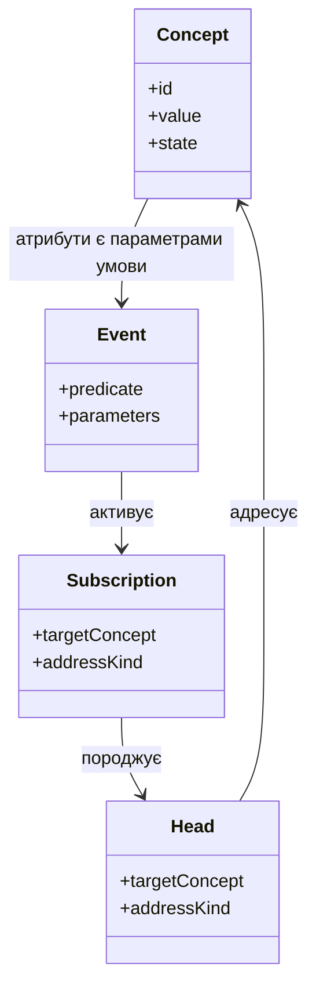
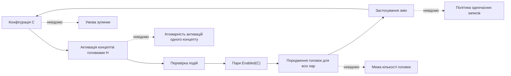
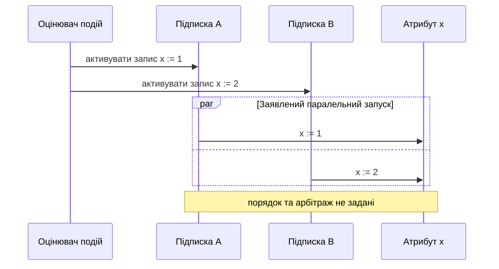
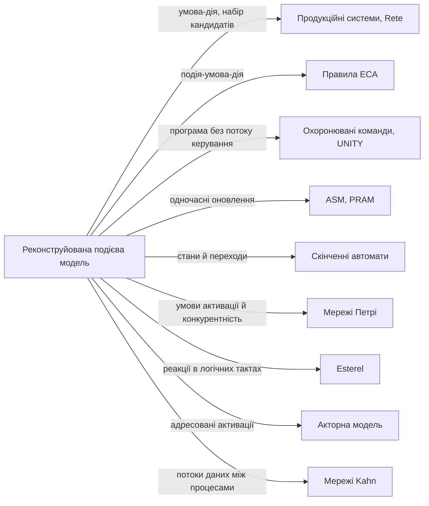
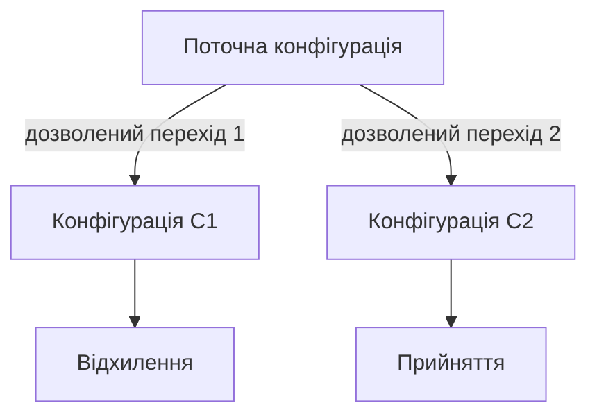
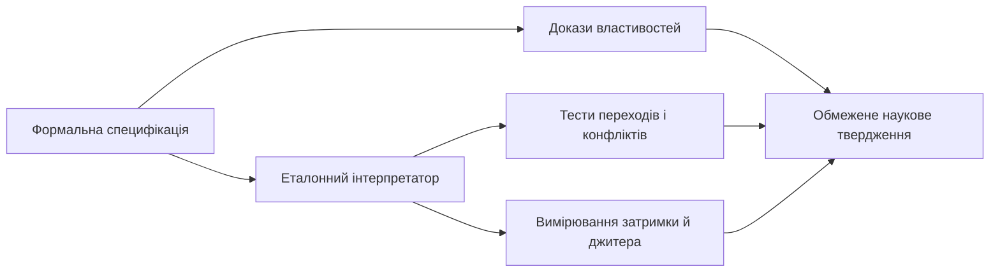
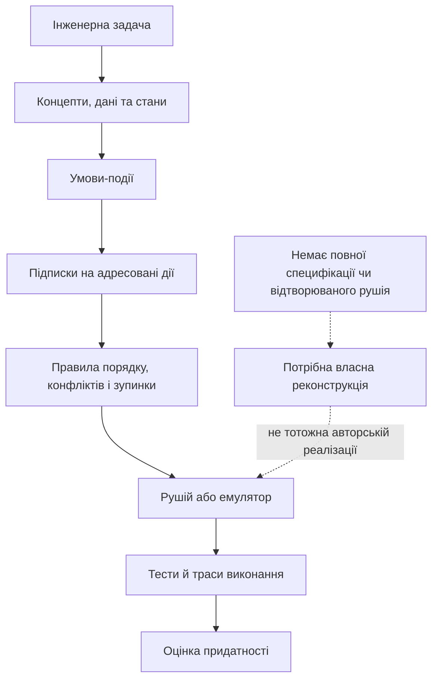

# Машина Кузьміна під формальним розбором: події, підписки й недоведені твердження
> **Автор:** Микола Федчик (Mykola Fedchyk)  
> **Предмет:** публічний опис Машини Кузьміна в 11 найновіших топіках автора на DOU (Developers of Ukraine) та його уточнення в обговоренні 2026 року.  
> **Мета:** реконструювати мінімальну формальну модель, відокремити її від заяв про обчислювальну потужність і визначити, яких означень, доказів та вимірювань бракує.

## Анотація

У дописах Михайла Кузьміна 2020–2023 років повторюється модель, у якій обчислення подаються як концепти зі станами, події-умови над цими станами й підписки, що запускають адресовані дії. Автор називає цю модель Машиною Кузьміна, пов’язує її з недетермінованою машиною Тюрінга, паралельним виконанням, автоматикою та новою архітектурою комп’ютера. Найповніше формулювання моделі в розглянутому корпусі автор навів у коментарі від 9 липня 2022 року: зліченна множина концептів, головки адресації, події як підмножини станів концепту й одночасний запуск усіх підписок на всі істинні події. У листопаді 2026 року автор назвав недетермінізм рекламним словом для паралельних обчислень, а розв’язання колізій поклав на програміста.

Публічних матеріалів достатньо, щоб реконструювати каркас моделі: концепти, події-умови, підписки, головки адресації та правило одночасного запуску. Матеріалів недостатньо, щоб однозначно визначити атомарність обробки активацій, політику одночасних записів, повторне спрацювання подій, межу кількості головок і умову зупинки. Повнота за Тюрінгом правдоподібна для варіанта моделі з необмеженою пам’яттю, але ескіз доказу 2026 року кодує лише таблицю переходів машини Тюрінга, а не її стрічку й рух головки. Класифікувати модель як недетерміновану машину Тюрінга не можна з іншої причини: у Машині Кузьміна виконуються всі гілки над спільною пам’яттю, а не одна з альтернатив. Перевагу над відомими моделями, зокрема заявлену швидкість реакції на події, не підтверджено вимірюваннями. Ці висновки стосуються доказової бази публічних дописів, а не всіх матеріалів автора.

## 1. Межі розбору

Розглядаю 11 найновіших публікацій, перелічених на [сторінці топіків Михайла Кузьміна на DOU](https://dou.ua/users/mihail-kuzmin/topics/), разом із коментарями автора в них. Перелік охоплює період від 10 липня 2020-го до 30 липня 2023 року. Окремо враховую відповіді автора в дискусії [«Машина Кузьміна»](https://dou.ua/forums/topic/35914/) від 4–5 листопада 2026 року. Ці відповіді автор дав на запитання, які я поставив у тій самій дискусії 2 листопада 2026 року, тобто рецензент брав участь в обговоренні, яке аналізує. Образливі репліки інших коментаторів не є свідченнями про коректність моделі й до технічного аналізу не включені.

Корпус не охоплює двох груп матеріалів. Перша група: давніші топіки, зокрема «Размышления за события. Определение» 2018 року, написаний більш ніж за три роки до топіка «Машина Кузьмина» (28.12.2021); означення в ньому можуть стосуватися ранішої версії задуму. Друга група: відеоканал автора, оголошений у топіку 44552; у 2026 році автор назвав цей канал місцем, де викладено доказ повноти за Тюрінгом. Відео не переглянуто, бо стаття спирається на текстові джерела, які можна цитувати дослівно. Обидві групи матеріалів можуть уточнити висновки розділів 3 і 5.

У статті розрізняю чотири рівні доказів:

- **опис**: автор назвав об’єкти та їхні зв’язки;
- **формальна специфікація**: правила однозначно визначають кожен крок виконання;
- **доказ властивості**: аргумент показує, що формальна модель має заявлену властивість;
- **експеримент**: доступний артефакт і протокол дають змогу відтворити вимірювання.

Наявність коду-подібного прикладу підтверджує, що автор запропонував спосіб запису. Вона не замінює формальну семантику, доказ або відтворюваний тест.

## 2. Реєстр тверджень у 11 топіках

| Топік | Що стверджує або демонструє автор | Що сам топік дозволяє перевірити |
|---|---|---|
| [«Обещал выложить свой проект. Делаю»](https://dou.ua/forums/topic/31011/) | Пам’ять подана як граф концептів; стани породжують події; підписки задають реакції. Наведені приклади лічильника енергії, маршрутизації пакетів і групових операцій. | Видно основну ідею та фрагменти власного синтаксису. У топіку немає доступного репозиторію з транслятором, специфікацією та тестами. |
| [«Новое за свой проект»](https://dou.ua/forums/topic/33771/) | Автор повідомляє про новий етап роботи, матеріал до наступної версії та пошук технічної й бізнесової допомоги. | Це звіт про стан проєкту, а не формальний опис або перевірка властивостей машини. |
| [«Недетерминированная машина Тьюринга. Архитектура. Язык. Система. Программирование»](https://dou.ua/forums/topic/35601/) | Представлено калькулятор як програмний демонстратор, транслятор і модель адресацій до концептів. Автор заявляє, що модель має бути придатною до реалізації на контролері. | Є пояснення задуму й приклади. Топік не містить апаратного протоколу, порівняльних вимірювань або доказу відповідності стандартній машині Тюрінга. |
| [«Машина Кузьмина. (Управляемая недетерминированная машина Тьюринга.)»](https://dou.ua/forums/topic/35914/) | Опис побудовано як перелік відмінностей від машини Тюрінга: «Лента конечна», замість комірок використано концепти, кілька головок мають чотири види адресації, стан належить концепту, а керування машиною полягає в додаванні й вилученні підписок. У коментарі від 29.12.2021 автор стверджує повноту: «Оставь в каждом концепте только одну подписку и получишь классическую МТ». Кілька підписок, за словами автора, породжують недетермінізм. | Описано кандидатну конструкцію, але не означено формально конфігурацію, крок, кодування стрічки, прийняття або правила гілкування. Формулювання «Лента конечна» несумісне з необмеженою пам’яттю, потрібною для повноти за Тюрінгом (розділ 5.2). |
| [«За недетерминированную машину и за не алгоритмы»](https://dou.ua/forums/topic/36255/) | Автор протиставляє підхід послідовному алгоритмічному опису, стверджує, що машина не має експоненційного вибуху, якщо не програмувати «глупостей», і приписує їй переваги для певного класу задач. | Не визначено клас задач, критерій «глупостей», межу ресурсів або оцінку складності, потрібні для перевірки цих тверджень. |
| [«Выполнение групп в недетерминированной машине»](https://dou.ua/forums/topic/36556/) | Описано групи, вибір операцій за подіями, цикли й арифметичні приклади, зокрема варіант алгоритму Евкліда. | Приклади конкретизують синтаксис і задум виконання. Вони не задають повну семантику одночасних дій, помилкових станів або завершення. |
| [«Как всегда о событиях»](https://dou.ua/forums/topic/38502/) | Автор визначає подію через стани або умови над станом і пропонує запускати перевірки паралельно, оскільки перевірка нібито не змінює пам’ять. Наводить сортування через порівняння й обмін сусідніх значень. | Показано приклад подієвого стилю. Не задано атомарність обміну, узгодженість паралельних змін, оцінку складності чи умови завершення сортування. |
| [«Автоматика и устройства. Есть проект, помогите разобраться, как найти инвестора»](https://dou.ua/forums/topic/38994/) | Автор пов’язує підхід з автоматикою й комерційними пристроями. У коментарі від 09.07.2022 наводить найповніше формулювання моделі (див. «Еволюція опису машини» нижче). 11.07.2022 називає головну мету: «не вычислительная мощность а скорость реакции на события». 08.07.2022 описує плату на мікроконтролері STM32 і дослідну партію з 20 плат, зібрану вручну, з приблизною собівартістю. | Формулювання 2022 року дає змогу реконструювати правило активації, але не атомарність і конфлікти записів. Заява про плати не є відтворюваним тестом обчислювальної моделі: топік не містить специфікації, схеми чи незалежних вимірювань. |
| [«Описание недетерминированной машины Кузьмина на пальцах»](https://dou.ua/forums/topic/43177/) | Подію визначено як «логическая функция от переменных»; кожна змінна-параметр такої функції має підписку на зміну значення, яка запускає перевірку події. У коментарях автор згадує транслятор і емулятор, а 25.04.2023 в одному повідомленні пише «20 образцов даже в железе есть» і «За полностью реализации в железе говорить рано». У прикладі з відеодекодуванням автор визнає, що задача детермінована. | Топік не містить загальнодоступного посилання на емулятор, специфікації апаратних зразків чи протоколу тестування, який можна відтворити. Приклад не демонструє переваги над наявними способами паралельного декодування. |
| [«Новини з проектом недетерминированной машины»](https://dou.ua/forums/topic/44449/) | Автор повідомляє про нову версію та пов’язує модель із автоматикою, інтегрованими пристроями й керуванням різними типами дронів. | Заявлені напрями застосування не супроводжуються специфікацією, демонстраційним набором чи вимірюваннями в цьому топіку. |
| [«Зробив канал, на якому розповідаю за нову архітектуру комп’ютера, мову та приклади»](https://dou.ua/forums/topic/44552/) | Автор оголошує канал з поясненнями й прикладами; у коментарях додає ідеї про навігаційні сенсори та універсальне керування рухомими платформами. | Канал є способом поширення матеріалів, але заяви в коментарях не є доказом працездатності конкретного сенсора чи системи керування. |

### Відповіді автора 2026 року

Відповіді від 4–5 листопада 2026 року автор дав на мої запитання про повноту за Тюрінгом, недетермінізм, твердження «більше, ніж алгоритми» та ефективність. У коментарі від 04.11.2026, 12:47 автор зробив кілька тверджень, на які спираються розділи 5 і 6:

- про повноту: «На моей машине можно моделировать любую МТ. Этого достаточно. Обратное меня не интересовало. Доказательство есть на канале»;
- про пам’ять: «Бесконечная память это просто слова для философских споров» і «Концептов, по моему, перечислимое число»;
- про недетермінізм: «Недетерминированная МТ это миф» і «Я у себя вижу (и предлагаю) параллельные вычисления. Для рекламы назвал недетерминизмом»;
- про алгоритми: «Алгоритм — детерминирован».

Через дві хвилини автор відповів на запит про експериментальні дані: їх немає, бо немає дослідного зразка ([3137527](https://dou.ua/forums/topic/35914/#3137527)). О 14:23 він навів ескіз симуляції машини Тюрінга ([3137565](https://dou.ua/forums/topic/35914/#3137565)): «Моделирование на моей машине МТ где множество значений А, множество состояний Q и множество действий D. Каждый переход переформулируем как множество событий S где sij событие из пары (аi, qj) и каждое событие sij подписано на dij». Тут `A` є алфавітом стрічки симульованої машини Тюрінга, `Q` є множиною її станів, `D` є множиною її дій, а кожен перехід `δ(qⱼ, aᵢ) = dᵢⱼ` подано подією `sᵢⱼ` з підпискою на дію `dᵢⱼ`. Отже, нотація `A`, `Q`, `D` описує кодування симульованої машини Тюрінга, а не загальне означення події Машини Кузьміна. Оцінку цього ескізу наведено в розділі 5.2. У тому самому коментарі автор нагадав, що підписки можуть виконуватися одночасно.

О 16:40 автор пояснив, що «А-ритмом» називає порядок виконання, який «быстро расползается и не является ни алгоритмом ни блок схемой» ([3137614](https://dou.ua/forums/topic/35914/#3137614)). 05.11.2026 о 08:43 він уточнив, що паралельні гілки створюються не лише адресацією на виконання, а й адресацією на читання чи запис, а за конфліктами програміст має стежити сам, «так как ветвление этого класса на одном логическом шаге» ([3137748](https://dou.ua/forums/topic/35914/#3137748)). Згадка про один логічний крок указує на синхронну семантику кроку, яку розглянуто в розділі 3.4.

### Еволюція опису машини

Означення пам’яті, події та правила виконання змінювалися між публікаціями. Таблиця фіксує формулювання, на які спирається реконструкція в розділі 3.

| Дата і джерело | Пам’ять | Подія | Виконання |
|---|---|---|---|
| 28.12.2021, текст топіка 35914 | «Лента конечна»; концепти замість комірок | Перехід концепту з одного стану в інший; окремі події адресації для читання, запису, виконання й ініціалізації | Кілька головок; переходи за кількома підписками можуть відбуватися одночасно |
| 30.12.2021, коментар у 35914 | «конечного числа пронумерованных ячеек»; підписка на ініціалізацію може створювати нові концепти | «Событием назовем изменение состояния концепта» | Підписки породжують нові головки; переходи «легко распараллеливаются», бо аналіз подій не змінює пам’ять |
| 09.07.2022, коментар у 38994 | «перечислимое множество ячеек»; множина станів комірки «возможно бесконечное» | Скінченна множина підмножин станів концепту; подія істинна, коли поточний стан належить її підмножині | Під час активації концепту машина перевіряє події з підписками й для всіх істинних подій та всіх їхніх підписок одночасно породжує головки |
| 24.04.2023, текст топіка 43177 | Стан є множиною поточних значень усіх змінних | «логическая функция от переменных» | Кожна змінна-параметр функції події має підписку на зміну значення, яка запускає перевірку події |
| 04.11.2026, коментарі в 35914 | «Концептов… перечислимое число»; нескінченна пам’ять названа темою «для философских споров» | Для симуляції машини Тюрінга подія є парою «символ стрічки, стан» | Підписки можуть виконуватися одночасно; конфлікти розв’язує програміст |

Найформальнішим є формулювання 2022 року: воно задає зліченну пам’ять, події як предикати над станом концепту й правило одночасного запуску всіх підписок. Опис 2023 року доповнює його механізмом повторної перевірки події після зміни параметра. Формулювання «Лента конечна» (2021) і теза 2026 року про нескінченну пам’ять як предмет філософських суперечок не узгоджуються з формулюванням 2022 року. Розділ 5.2 показує, чому від вибору між цими варіантами залежить відповідь про повноту за Тюрінгом.

### Апаратні зразки

У коментарі до топіка 38994 від 08.07.2022 автор описав плату, для якої обрано «проц самый дешевый stm32», і повідомив: «Опытную партию 20 штук здесь делали и паяли в ручную». У коментарі до топіка 43177 від 25.04.2023 він в одному повідомленні написав «20 образцов даже в железе есть» і «За полностью реализации в железе говорить рано. Вполне реально (и не сложно) реализовать виртуальную машину». У 2026 році автор сказав, що дослідного зразка немає.

Ці формулювання можна узгодити, але таке узгодження є інтерпретацією, а не підтвердженим автором фактом. Найімовірніше, 20 зразків є платами на мікроконтролері STM32, які виконують програмне середовище автора, а відсутній дослідний зразок є спеціалізованою апаратною реалізацією машини. З цієї інтерпретації випливають два наслідки. По-перше, плати не перевіряють апаратної паралельності: найдешевші мікроконтролери серії STM32 мають одне обчислювальне ядро Arm Cortex-M, тому «одночасні» підписки на них виконуються почергово. По-друге, плати показують, що модель виконується на звичайному процесорі з архітектурою фон Неймана; це важливо для оцінки твердження «більше, ніж алгоритми» в розділі 6.

## 3. Формальна реконструкція

### 3.1. Робоче наукове визначення

За розглянутими публічними матеріалами **Машину Кузьміна можна реконструювати як подієву обчислювальну модель**, у якій предметні об’єкти подано концептами зі значеннями й станами, події є умовами над цими станами, підписки пов’язують події з адресованими діями, а головки адресації переносять активацію від концепту до концепту. За формулюванням 2022 року активація концепту запускає перевірку його подій, і для кожної істинної події та кожної її підписки машина одночасно породжує нову головку. Це визначення описує спільну частину публічних пояснень автора, але не є завершеним формальним означенням: джерела не задають атомарності активацій, політики одночасних записів, повторного спрацювання подій, умови зупинки й ресурсних обмежень.

### 3.2. Які проблеми має розв’язати пропозиція

Автор прямо називає одну мету. У коментарі від 11.07.2022 він пише, що головна мета «не вычислительная мощность а скорость реакции на события. Даже параллельность.» Цю мету можна виміряти як затримку й джитер між подією та реакцією на неї. Інші цілі в дописах сформульовано без метрик, тому їх треба відрізняти від доведених результатів:

| Заявлена проблема | Запропонований напрям розв’язання | Що дають наявні джерела |
|---|---|---|
| Швидко реагувати на події в автоматиці. | Запускати реакцію підпискою на подію, а не місцем команди в послідовності програми. | Метрика випливає з мети автора: найгірша затримка й джитер «подія → дія». Вимірювань у корпусі немає; план вимірювання наведено в розділі 7.1. |
| Описати процеси, у яких дії залежать від поточних станів і подій, не зводячи програму до звичайної послідовності команд. | Подати предметні об’єкти як концепти, а реакції на стани й події як граф підписок на дії. | Є текстові приклади й опис графа виконання. Не показано, для яких задач таке подання простіше, точніше або дешевше за машини станів чи продукційні системи. |
| Виконувати кілька незалежних реакцій паралельно й отримати практичну перевагу в часі або пропускній здатності. | Запускати всі підписки на істинні події одночасно. | Автор заявляє про паралельність і в 2026 році згадує один логічний крок, але не задає видимість змін, правила конфліктів або порівняльні вимірювання. |
| Застосувати модель до автоматики, вбудованих пристроїв і керування. | Реалізувати граф реакцій у віртуальній машині на мікроконтролері або в спеціалізованому обладнанні. | У дописах названо такі напрями й 20 плат на STM32, але в розглянутому корпусі немає відтворюваного прототипу з інтерфейсами, тестами та метриками для конкретної задачі. |
| Уникнути експоненційного зростання паралельних гілок або отримати обчислювальні можливості понад звичайні алгоритмічні моделі. | Автор пов’язує ці твердження з паралельним виконанням і способом програмування. | Без формального класу задач, ресурсної моделі, визначення «неправильної програми» та доказу ці заяви не задають перевірної інженерної проблеми (розділ 6). |

Отже, найконкретніша задача пропозиції полягає в описі та швидкому виконанні станозалежних реакцій у графі концептів. Чи розв’язує такий підхід цю задачу краще за наявні засоби, можна встановити лише для названого класу задач за визначеними метриками й базовим порівнянням.

### 3.3. Об’єкти моделі та конфігурація

Мінімальну аналітичну модель позначу так:

```text
M_K^rec = (V, σ, E, D, R, Π),   R ⊆ E × D
```

Тут:

- `V` є множиною концептів; за формулюванням 2022 року вона зліченна, а нові концепти створюються адресацією на ініціалізацію;
- `σ` задає значення й стан кожного концепту;
- `E` є множиною подій; подію записую як `e = (φ, vars(φ))`, де `φ` є булевою функцією над атрибутами концептів з множини `vars(φ)`, як в описі 2023 року («логическая функция от переменных»); формулювання 2022 року є окремим випадком, у якому `φ` перевіряє, чи належить стан одного концепту заданій підмножині станів;
- `D` є множиною дій, тобто адресованих операцій читання, запису, виконання й ініціалізації;
- `R` є відношенням підписок між подіями й діями;
- `Π` має визначати політику виконання: атомарність, обробку конфліктів, повторне спрацювання подій, зупинку й обмеження ресурсів.

Позначка `rec` вказує, що це моя реконструкція, а не нотація чи специфікація автора. Подія з кількома параметрами потрібна, бо приклади автора використовують умови над кількома атрибутами: перевірку меж `Value`, `Up`, `Down` у топіку 43177 і порівняння сусідніх значень під час сортування в топіку 38502. Саме `Π` у доступних джерелах не визначена, тому кортеж задає структуру для аналізу, але ще не визначає виконувану машину.

Конфігурація обчислення має містити все, що може змінюватися під час виконання:

```text
C = (V, σ, R, H)
```

Тут `V` входить до конфігурації, бо концепти можуть створюватися; `R` входить, бо за текстом топіка 35914 «Управление конкретной машиной осуществляется добавлением/удалением подписок»; `H` є множиною активних головок адресації. Головки описано в джерелах прямо: підписки «порождают новые головки», а «работа головки завершается по выполнению вида адресации». Отже, `H` є частиною моделі автора, а не лише реконструкційним припущенням. Невизначеним лишається тип `H`: черга, множина чи мультимножина головок.

Статичні зв’язки між сутностями моделі можна подати діаграмою класів:



Це схема сутностей, а не підтверджена структура програмного коду. Вона не задає кількість зв’язків між об’єктами, типи даних чи спосіб зберігання підписок.

| Характеристика | Що відомо і чого бракує |
|---|---|
| **Подання обчислення** | Граф концептів, значень, станів і підписок; за формулюванням 2022 року множина концептів зліченна. Формат пам’яті не заданий. |
| **Події** | Предикат над станом концепту (2022) або булева функція від кількох змінних (2023). Подію перевіряють під час активації концепту й після зміни параметра. Повторне спрацювання, поки предикат залишається істинним, не врегульоване (розділ 3.4). |
| **Підписки й головки** | Підписка задає концепт і вид адресації; для кожної істинної події й кожної підписки породжується головка. Межа кількості головок не задана. |
| **Виконання** | Автор називає порядок виконання «А-ритмом» і згадує один логічний крок. Атомарність активацій одного концепту й арбітраж конфліктних записів не визначені. |
| **Клас обчислень** | Ранні назви містять недетерміновану машину Тюрінга; у 2026 році автор назвав недетермінізм рекламним словом для паралельності. Аналіз наведено в розділі 5. |
| **Практична реалізація** | Згадано калькулятор, транслятор, емулятор, віртуальну машину й 20 плат на STM32. У розглянутому корпусі немає повної специфікації та відтворюваного набору артефактів для незалежного запуску й перевірки. |

### 3.4. Крок виконання

Щоб реконструювати крок, треба відповісти на запитання: які пари «подія-дія» можуть спрацювати в поточній конфігурації? Множину таких пар означу так:

```text
Enabled(C) = { (e, d) ∈ R | Active(e, C) }
```

Тут `C` є поточною конфігурацією, `R` відношенням підписок, а `Active(e, C)` означає, що подію `e` перевірено в конфігурації `C` і її предикат істинний. Наприклад, якщо `R` містить пари `(e, d₁)` і `(e, d₂)`, а подія `e` активна, то обидві пари належать `Enabled(C)`. Формула визначає кандидатів на виконання, але не результат їхнього застосування.

Джерела відповідають на запитання, коли перевіряється подія: під час активації концепту (2022) і після зміни будь-якої змінної-параметра (2023). Отже, подія є умовою рівня, яку перевіряють у визначені моменти, а не фронтом переходу між станами. Відкритим лишається повторне спрацювання. Якщо параметр змінився, а предикат залишився істинним, за описом 2023 року перевірка запуститься знову й підписки виконаються ще раз. У продукційних системах для такої ситуації існує правило рефракції: те саме зіставлення правила з тими самими даними вдруге не спрацьовує [21]. Для Машини Кузьміна подібного правила не описано.

Набір пар, які виконуються за один крок, позначу `B(C) ⊆ Enabled(C)`. За формулюванням 2022 року `B(C) = Enabled(C)`: машина запускає всі підписки на всі істинні події одночасно. Цього недостатньо для визначення кроку, бо в конфігурації одночасно існує кілька головок, і треба задати, як вони застосовують зміни до спільних концептів. Для цього потрібне відношення кроку всієї машини `C → C'` і вибір однієї з двох семантик:

- **Почергова семантика.** За один крок обробляється одна головка з `H`. Вибір головки є джерелом недетермінізму навіть тоді, коли обробка кожної окремої головки детермінована.
- **Синхронна семантика.** За один крок обробляються всі головки з `H`, а їхні зміни застосовуються разом. На цей варіант указують слова «одновременно» (2022) і «на одном логическом шаге» (2026). Тоді недетермінізм або помилка виникають лише через конфліктні записи.

Модель детермінована, якщо для кожної конфігурації `C` існує щонайбільше одна конфігурація `C'`, така що `C → C'`. Означення детермінізму через окрему активацію, наприклад через функцію `δ(C, activation)`, недостатнє, бо приховує вибір самої активації.



Діаграма показує етапи реконструйованого кроку за описами 2022–2023 років. Пунктирні стрілки ведуть до чотирьох правил, без яких функцію переходу `C → C'` не можна визначити однозначно. Без цих правил ту саму схему можна реалізувати як різні машини з різними результатами.

### 3.5. Конкурентність і конфлікти записів

Припустімо, дві підписки на одну подію одночасно змінюють атрибут `x`: перша виконує `x := 1`, друга `x := 2`. Якщо дії виконуються послідовно, кінцеве значення залежить від їхнього порядку. Якщо обидві записують паралельно, потрібне правило арбітражу. Якщо рушій забороняє такі конфлікти, специфікація має визначити, як конфлікт виявляється і яка реакція на нього. Діаграма послідовності фіксує заявлений паралельний запуск і місце невизначеного арбітражу:



Схема не задає, яке значення отримає `x`. Вона показує, де потрібні правила атомарності, порядку виконання або відхилення конфліктної пари дій.

Друга ситуація підступніша, бо її не виявляє перевірка порядку. Нехай обидві дії `u` і `v` виконують `x := x + 1`. Щоб з’ясувати, чи залежить результат від порядку, порівнюють два послідовні виконання:

```text
u(v(C)) = v(u(C))
```

Тут `u(v(C))` означає, що спершу виконано `v`, потім `u`. Рівність означає, що порядок двох **атомарних** дій не змінює кінцевого стану. Для `x₀ = 5` обидва порядки дають `x = 7`, тож рівність виконується. Однак якщо обидві дії одночасно прочитають `x₀ = 5` й обидві запишуть `6`, одне оновлення буде втрачено. Отже, комутативність достатня для незалежності від порядку лише за умови атомарності й не гарантує безпечного одночасного виконання.

Для одночасного виконання без синхронізації достатні умови Бернштейна [10]:

```text
R(u) ∩ W(v) = ∅,   W(u) ∩ R(v) = ∅,   W(u) ∩ W(v) = ∅
```

Тут:

- `R(u)` і `R(v)` є множинами атрибутів, які дії читають;
- `W(u)` і `W(v)` є множинами атрибутів, які дії записують;
- `∅` позначає порожню множину.

Умови читаються так: жодна дія не читає атрибут, який записує інша, і дві дії не записують той самий атрибут. Для прикладу з `x := x + 1` маємо `R(u) = W(u) = R(v) = W(v) = {x}`, тож усі три перетини непорожні, і одночасне виконання потребує синхронізації. Умови треба перевіряти для всіх досяжних станів, а не для однієї конфігурації. Твердження автора, що перевірка подій не змінює пам’ять, задовольняє умови Бернштейна лише для самих перевірок; дії, які ці перевірки запускають, треба аналізувати окремо.

Для конфліктних записів існують готові політики, і специфікація Машини Кузьміна може вибрати одну з них. Модель паралельних обчислень зі спільною пам’яттю PRAM (Parallel Random Access Machine) має варіанти, що забороняють одночасний запис (EREW: exclusive read, exclusive write; CREW: concurrent read, exclusive write), і варіанти, що його дозволяють (CRCW: concurrent read, concurrent write). У варіантах CRCW записи дозволено лише з однаковим значенням (common), успішним стає довільний запис (arbitrary) або запис процесора з найвищим пріоритетом (priority) [18]. В абстрактних машинах станів (Abstract State Machines, ASM) крок формує множину оновлень, а суперечлива множина, як-от `x := 1` і `x := 2`, не дає наступного стану [17]. Інший шлях дає акторна модель: якщо кожен концепт обробляє одну активацію за раз, станів гонитви всередині концепту немає, а недетермінізм зводиться до порядку надходження головок [19]. Тому для специфікації визначальне запитання таке: чи обробляє концепт одну активацію за раз?

## 4. Відомі аналоги й межі порівняння

Робоче визначення в розділі 3 описує концепти, події-умови, підписки, головки адресації й одночасний запуск реакцій. Ці ознаки належать до різних рівнів, тому модель доцільно порівнювати з кількома формалізмами, кожен з яких дає точні поняття для окремого аспекту. Структурна подібність не доводить ані тотожності семантики, ані переваги, ані відсутності новизни.



Стрілки позначають лише аспект для порівняння. Вони не означають, що Машина Кузьміна вже має семантику відповідного формалізму. Перші чотири формалізми найближчі до реконструйованої моделі, тому в таблиці вони стоять першими.

| Формалізм | Який аспект можна зіставити | Межа аналогії та потрібна перевірка |
|---|---|---|
| **Продукційні системи та алгоритм Rete** | Програма продукційної системи складається з правил «умова → дія». На кожному циклі рушій будує набір конфліктів, тобто всі правила з істинними умовами, вибирає правило за стратегією розв’язання конфліктів і виконує його дію [21]. `Enabled(C)` відповідає набору конфліктів, `B(C)` відповідає стратегії вибору, а питання повторного спрацювання відповідає правилу рефракції. Алгоритм Rete зберігає часткові зіставлення й перевіряє лише умови, залежні від змінених даних [13]. | Продукційна система OPS5 виконує одне правило за цикл, а Машина Кузьміна заявляє одночасний запуск усіх підписок. Треба показати, яку перевагу дає одночасний запуск і як він узгоджується з конфліктами. Автор відкидає претензії «за количество лишних проверок», але на одноядерному мікроконтролері кожна зайва перевірка додає затримку, а Rete показує, як цю затримку зменшують. |
| **Правила ECA в активних базах даних** | Правило «подія-умова-дія» (Event-Condition-Action, ECA) спрацьовує на подію, перевіряє умову й виконує дію. Дослідження активних баз даних формалізують моделі виконання правил, їхній зв’язок із транзакціями й завершення каскадів правил [14]. | В активних базах даних дії правил виконуються в межах транзакцій, що забезпечує атомарність. Для Машини Кузьміна аналогічного механізму не описано. |
| **Охоронювані команди Дейкстри та UNITY** | Програма є множиною охоронюваних дій «умова → присвоєння» без явного потоку керування; виконується дія, умова якої істинна [15, 16]. «Блок-схема без ліній» з топіка 43177 структурно відповідає такій програмі. | У UNITY вибір дії недетермінований із вимогою справедливості, а коректність доводять інваріантами й властивостями поступу. Для Машини Кузьміна справедливість і поступ не визначені. |
| **ASM і PRAM** | Дають точну семантику одночасних оновлень спільного стану та готові політики конфліктних записів (розділ 3.5) [17, 18]. | Ці моделі не є аналогом усієї Машини Кузьміна, а пропонують мову для специфікації кроку. Треба вибрати політику й показати, що мова автора її дотримується. |
| **Скінченні автомати** | Дає базову модель скінченного керування через стани й переходи. Це доречна точка порівняння для станів концепту та реакції на умови [2]. | Автомат не пояснює сам собою граф підписок, адресовані операції або паралельний доступ до спільних даних. Треба визначити, чи стани концептів утворюють скінченний простір і як події породжують переходи. |
| **Мережі Петрі** | Формалізують умови дозволеності переходів, стан у вигляді розмітки та конкурентне спрацювання [3]. | У мережі Петрі стан задається токенами в місцях, а не довільними атрибутами концептів. Потрібне явне кодування, що зберігає дозволені переходи й результати конфліктних дій; сам граф концептів такого кодування не задає. |
| **Синхронна реактивна мова Esterel** | Дає формальну семантику реакцій на події та одночасних дій у логічних тактах [6]. | Автор згадує «один логічний крок», але не визначає, які реакції належать до одного кроку, коли зміни стають видимими й за якою умовою реакція завершується. Порівняння потребує відповіді, чи має рушій синхронну або асинхронну семантику. |
| **Акторна модель** | Актор має локальний стан і реагує на отримані повідомлення, надсилаючи нові повідомлення [19]; процеси Erlang обробляють повідомлення зі своєї черги послідовно [4]. За формулюванням 2022 року головка є одноразовою адресацією концепту, що близько до повідомлення актору. | Описи Машини Кузьміна допускають адресоване читання й запис інших концептів, тоді як актори не мають спільного стану. Треба встановити, чи обробляє концепт одну активацію за раз, чи є стан спільним і хто обробляє конфліктні записи. |
| **Мережі потоків даних Kahn** | Дають формальну модель паралельних процесів, що обмінюються даними через канали [5]. | Потік даних через канали не тотожний подіям і підпискам на зміну атрибутів. Для порівняння треба визначити канали, буферизацію, блокування, детермінованість і чи змінюється сам граф виконання. |

Порівняння має відбуватися за однаковими критеріями: які конфігурації представляються, які переходи дозволені, як діляться чи ізолюються дані, як задається паралельність і що вважається завершенням. Поки політика виконання `Π` не визначена, не можна довести формальну еквівалентність, відмінну обчислювальну потужність або технологічну перевагу Машини Кузьміна над наведеними аналогами. Питання повноти за Тюрінгом розглянуто окремо в розділі 5.

## 5. Чи є це недетермінованою машиною Тюрінга?

### 5.1. Недетермінізм і одночасне виконання гілок

У стандартній недетермінованій машині Тюрінга (Nondeterministic Turing Machine, NTM) одна конфігурація може мати кілька дозволених наступних конфігурацій. Обчислення утворює дерево гілок, кожна гілка має власну копію стрічки, а вхід приймається, якщо принаймні одна гілка доходить до приймального стану [2, 8]. Формальне поняття недетермінованого автомата ввели Рабін і Скотт [9]. Позначу машину Тюрінга як TM (Turing Machine). Недетермінована машина Тюрінга є математичним означенням відношення переходу, а не описом фізичного пристрою: означення не вимагає, щоб головка фізично мала кілька станів одночасно. Тому заперечення автора 2026 року («Недетерминированная МТ это миф») стосується фізичної реалізації, а не означення.

Дерево нижче показує правило прийняття для недетермінованої машини Тюрінга: достатньо однієї приймальної гілки. Гілки є альтернативами формальної моделі; схема не стверджує, що фізичний процесор виконує їх одночасно.



Структура виконання в Машині Кузьміна інша. За формулюванням 2022 року машина запускає **всі** підписки на **всі** істинні події, і гілки працюють над **спільною** пам’яттю. У недетермінованій машині Тюрінга гілки є **альтернативами** з окремими копіями стрічки, а прийняття визначає існування хоча б однієї приймальної гілки. Перше є розгалуженням паралельного виконання, друге є екзистенційним вибором. Розгалуження над спільною пам’яттю ближче до моделей PRAM і акторів, ніж до недетермінованої машини Тюрінга.

Назва «Управляемая недетерминированная машина Тьюринга» й теза, що конфлікти розв’язує програміст, ближчі до іншого поняття з тієї самої статті Тюрінга. У §2 статті 1936 року Тюрінг описує машини вибору (choice machines, c-machines), рух яких конфігурація визначає лише частково; у неоднозначній конфігурації машина чекає довільного вибору зовнішнього оператора [1]. Ця аналогія не означає тотожності моделей. Вона показує, що керований ззовні вибір має в теорії обчислень окрему назву й не збігається із сучасним означенням недетермінізму.

Щоб класифікувати модель, потрібні відповіді на чотири запитання:

1. Чи є підписки альтернативними переходами, де обчислення обирає один шлях, чи всі підписки мають виконатися? Формулювання 2022 року відповідає: виконуються всі.
2. Як комбінуються стани гілок? За описами автора гілки працюють зі спільною пам’яттю, але правило застосування конфліктних змін не задане (розділ 3.5).
3. Що вважається прийняттям, відхиленням і зупинкою обчислення? Не визначено.
4. Як обмежені ресурси реалізації впливають на кількість головок, яка в абстрактній машині може зростати без обмежень? Не визначено (розділ 6).

У відповіді 2026 року Кузьмін прямо назвав недетермінізм рекламним словом для паралельності. Тому стаття оцінює дві окремі версії твердження: «модель є недетермінованою машиною Тюрінга» і «модель запускає конкурентні реакції». Перша версія не відповідає описаній автором структурі виконання. Друга потребує моделі планування й синхронізації (розділ 3.4).

### 5.2. Повнота за Тюрінгом

Перше твердження автора, «Оставь в каждом концепте только одну подписку и получишь классическую МТ» (29.12.2021), не є доказом. Одна підписка на концепт справді дає не більше однієї нової головки на активацію, тобто послідовне виконання, але не показує, як закодовано стрічку.

У 2026 році автор навів ескіз (розділ 2): кожен перехід `δ(qⱼ, aᵢ) = dᵢⱼ` кодується подією `sᵢⱼ` з підпискою на дію `dᵢⱼ`. Ескіз кодує скінченне керування, тобто таблицю переходів. Для повного доказу бракує чотирьох частин: кодування стрічки концептами, позиції головки, зсуву головки ліворуч або праворуч і зупинки.

Вирішальною частиною доказу є пам’ять. Якщо множина концептів скінченна, діапазон значень кожного концепту скінченний і іншої необмеженої пам’яті немає, модель має скінченну кількість конфігурацій і за обчислювальною потужністю не перевищує скінченного автомата. Для повноти за Тюрінгом потрібна необмежена пам’ять, але не обов’язково необмежена кількість концептів. Мінський довів, що машина з двома лічильниками необмежених натуральних чисел, які можна збільшувати, зменшувати й перевіряти на нуль, повна за Тюрінгом [11]. Отже, достатньо скінченної кількості концептів, якщо щонайменше два з них мають необмежений діапазон значень. Формулювання 2022 року допускає такий варіант («множество состояний (возможно бесконечное)»), а арифметичні приклади автора, зокрема алгоритм Евкліда в топіку 36556, уже оперують цілими змінними, які можна використати як лічильники. Для автора найкоротшим доказом, імовірно, буде симуляція машини з двома лічильниками, а не машини Тюрінга зі стрічкою.

Формулювання автора різних років розходяться саме в цьому пункті: «Лента конечна» (2021), зліченна множина комірок і, можливо, нескінченна множина станів (2022), нескінченна пам’ять як тема «для философских споров» (2026). Якщо «Лента конечна» означає скінченну пам’ять без необмеженого створення нових концептів, модель не повна за Тюрінгом; за формулюванням 2022 року повнота правдоподібна. Тому специфікація має явно вибрати модель пам’яті. Кожен фізичний комп’ютер має скінченну пам’ять, тож повнота за Тюрінгом є властивістю абстрактної моделі, а не пристрою.

Доказ симуляції має задати кодування `Enc` від конфігурації машини Тюрінга до конфігурації Машини Кузьміна й довести, що кожен крок вихідної машини відтворюється скінченною кількістю кроків цільової моделі:

```text
c →TM c'  ⇒  Enc(c) →*K Enc(c')
```

Тут `c` і `c'` є конфігураціями машини Тюрінга, `→TM` означає один її перехід, `→*K` означає нуль або більше кроків Машини Кузьміна. Для повної еквівалентності розв’язання задачі треба також зберегти зупинку й прийняття. Оскільки Машина Кузьміна може мати кілька головок і різні порядки їх обробки, треба довести, що **кожне** допустиме виконання з `Enc(c)` доходить до `Enc(c')`, а не лише одне з них; інакше вибір планувальника може привести до хибного результату.

Такий доказ установив би, що абстрактна модель може симулювати TM за визначених припущень. Він не довів би, що фізична реалізація має необмежену пам’ять, виконує експоненційно багато гілок або швидше розв’язує задачі, повні для класу NP (nondeterministic polynomial time, недетермінований поліноміальний час).

Повнота за Тюрінгом, найімовірніше, досяжна, але вона не вирізняє модель: мови програмування загального призначення також повні за Тюрінгом. Тому для оцінки пропозиції визначальними є семантика конкурентності (розділ 3) і заявлена швидкість реакції на події (розділи 6 і 7).

## 6. Оцінка основних заяв

### «Більше, ніж алгоритми»

Аргумент автора 2026 року короткий: «Алгоритм — детерминирован», а його машина виконує паралельні процеси. У 2023 році він додавав, що порядок у визначенні алгоритму не стосується часу виконання. Це протиставлення спирається на вузьке означення алгоритму. Недетерміновані алгоритми описано щонайменше з 1967 року [12], а паралельні й розподілені алгоритми є окремим розділом теорії алгоритмів. Тому протиставлення є термінологічним і не показує, що модель виходить за межі алгоритмічної обчислюваності.

Сильніший аргумент випливає з власних заяв автора. Він повідомляє про транслятор, емулятор і віртуальну машину для мікроконтролера STM32. Якщо ці програми правильно реалізують модель, то її виконує звичайний процесор, а отже, машина Тюрінга може симулювати Машину Кузьміна. У такому разі модель не обчислює функцій, недоступних машині Тюрінга. Автор зазначив, що зворотна симуляція його не цікавила («Обратное меня не интересовало»), але саме вона вирішує питання «більше, ніж алгоритми». Якщо автор стверджує обчислення функцій, недоступних машині Тюрінга, потрібна явна операція, яку машина Тюрінга не може обчислити, наприклад звернення до оракула; паралельне розгалуження такої операції не дає.

### «Немає експоненційного вибуху, якщо програмувати розумно»

У топіку про «не алгоритми» автор заперечує, що розмноження гілок є неминучою проблемою. За формулюванням 2022 року кожна активація породжує по головці для кожної підписки на кожну істинну подію. Якщо граф підписок містить цикл, у якому кожна активація породжує дві головки, то кожна головка на кожному кроці замінюється двома, і після `n` кроків кількість головок дорівнює `2^n`. Наприклад, після 20 кроків одночасно існуватиме понад мільйон головок. Твердження автора можна перевірити лише тоді, коли специфікація визначить, які програми вважаються «глупостями», і задасть межу кількості головок або операцію їх злиття з доказом коректності.

Ця заява не узгоджується з назвою машини. Перевага недетермінованої машини Тюрінга в теорії складності походить саме з експоненційної кількості незалежних гілок. Якщо експоненційного вибуху немає, немає й цієї переваги.

### «Перевірки можна виконувати паралельно, бо вони не змінюють стан»

Незмінність перевірки усуває лише побічний ефект самої перевірки. Вона не доводить, що підписані дії незалежні: дві реакції можуть змінювати той самий концепт або читати дані, які одна з реакцій змінює (розділ 3.5). Крім того, незмінність стану не робить перевірки безкоштовними. Автор відкидає претензії «за количество лишних проверок», але на одноядерному мікроконтролері кожна зайва перевірка забирає процесорний час і збільшує затримку реакції, тобто саме ту величину, яку автор називає головною метою. Продукційні системи зменшують цю ціну інкрементним зіставленням, як в алгоритмі Rete [13].

### «Швидше за класичний процесор» і прикладні заяви

Перевага швидкодії не випливає з графового подання, кількості підписок або кількості логічних гілок. Верхню межу прискорення дає закон роботи для паралельних обчислень:

```text
T_p ≥ T_1 / p
```

Тут:

- `T_1` є часом виконання всієї роботи на одному процесорі;
- `p` є кількістю фізичних процесорів;
- `T_p` є часом виконання тієї самої роботи на `p` процесорах.

Нерівність читається так: `p` процесорів прискорюють обчислення не більше ніж у `p` разів, бо за одиницю часу вони виконують не більше `p` одиниць роботи. Ілюстративний приклад: якщо програма виконується на одному ядрі за 80 мс, то на чотирьох ядрах вона не виконається швидше ніж за 20 мс, хоч би скільки логічних гілок мала. Нерівність не враховує витрат на синхронізацію й доступ до пам’яті, тому реальне прискорення зазвичай менше. Брент показав для паралельного обчислення арифметичних виразів, що цієї межі можна досягти з точністю до доданка, який залежить від довжини найдовшого ланцюжка залежних операцій [20]. З нерівності випливає, що апаратура зі сталою кількістю процесорів не перетворює експоненційний час на поліноміальний.

Для заявленої мети автора, швидкості реакції на події, потрібні два окремі результати: коректність реалізації за специфікацією та порівняльне вимірювання затримки на однакових задачах (розділ 7.1). Для тверджень про автоматизацію, нейронні мережі чи керування дронами потрібні окремі прототипи, метрики, базові лінії порівняння й оцінка відмов. Жоден із цих результатів не можна вивести з демонстрації калькулятора чи з текстової схеми.

## 7. Мінімальний пакет для наукової перевірки й шлях до прототипу

### 7.1. Що потрібно для перевірки

Щоб перетворити задум на модель, яку можна рецензувати й відтворити, потрібен такий комплект:

1. **Версійована специфікація.** Однозначно означити концепт, стан, подію, підписку, головку, вид адресації, дію, конфігурацію, крок, зупинку та результат. Явно вибрати модель пам’яті: скінченну чи необмежену. Відокремити абстрактну машину від транслятора, віртуальної машини й апаратної реалізації.
2. **Операційна семантика кроку.** Вибрати почергову або синхронну семантику (розділ 3.4), визначити, чи обробляє концепт одну активацію за раз, задати політику конфліктних записів (наприклад, один із варіантів PRAM або правило ASM з розділу 3.5), правило повторного спрацювання подій, межу кількості головок і умову зупинки.
3. **Доказ обчислювальної потужності.** Подати конструктивну симуляцію машини з двома лічильниками або машини Тюрінга й довести, що кожне допустиме виконання відтворює крок вихідної машини (розділ 5.2). Для класифікації моделі довести також зворотну симуляцію.
4. **Виконуваний еталон.** Опублікувати інтерпретатор або емулятор зі стабільною версією, інструкцією запуску й кількома повними прикладами. Додати тести на кожне правило й граничний випадок, зокрема конкурентні записи й завершення, а також траси, що показують причину кожного спрацювання. Якщо програма реалізує власно реконструйовані правила, позначити її як реконструкцію, а не авторську реалізацію.
5. **Порівняльний експеримент для заявленої мети.** До запуску зафіксувати задачу автоматики, вхідні події, обладнання й версії інструментів. Основні метрики: найгірша затримка й джитер «подія → дія», використання пам’яті й процесорного часу. Базові реалізації тієї самої логіки на тій самій платі STM32: обробник переривань (Interrupt Service Routine, ISR), задача операційної системи реального часу (Real-Time Operating System, RTOS) і цикл сканування, як у програмованому логічному контролері (Programmable Logic Controller, PLC).
6. **Апаратна реалізація, якщо заявляється її перевага.** Опублікувати специфікацію пристрою, інтерфейси та обмеження, описати зв’язок апаратних операцій із семантикою кроку й повторити вимірювання на тому самому класі задач.



Цей порядок не вимагає спочатку будувати спеціальний процесор. Спершу можна перевірити семантику на звичайному комп’ютері. Якщо програмний емулятор не може однозначно визначити результат конфліктного запису, спеціалізоване обладнання лише прискорить виконання недовизначених правил.

### 7.2. Шлях інженера до прототипу

Публічні матеріали описують концепти, події, підписки, головки адресації й правило одночасного запуску (розділ 3), а також згадують калькулятор, транслятор, емулятор і віртуальну машину. Цих відомостей недостатньо, щоб інженер міг узяти готовий інструмент і написати на ньому програму: у розглянутих матеріалах немає повної специфікації мови, доступної реалізації з інструкціями запуску, тестового набору й контракту конкурентності. Тому нижче описано не спосіб користування авторським програмним продуктом, а шлях до прототипу за аналітичною реконструкцією.

Для задачі керування температурою інженер міг би подати датчик і охолоджувач як концепти, визначити умову перевищення порога й підписати її на запуск охолодження. Такий запис є лише ілюстративним псевдокодом, а не синтаксисом Машини Кузьміна:

```text
when Датчик.температура > межа:
    activate Охолоджувач.увімкнути
```

Щоб перетворити цей начерк на виконувану програму, треба визначити, як зберігається `Датчик.температура`, що означає `activate` і як рушій повідомляє про помилку охолоджувача. Окремо треба врегулювати повторне спрацювання: за описом 2023 року кожне нове вимірювання температури запускає перевірку умови, тож поки температура перевищує межу, команда увімкнення надходитиме охолоджувачу після кожного вимірювання. Якщо та сама подія запускає ще й тривогу, специфікація має визначити, як обидві головки застосовують зміни, як обробляється частковий збій і що відбувається при повторній активації.

Отже, інженерний робочий процес мав би охопити такі кроки:

1. Визначити концепти предметної області, їхні ідентифікатори, дані й стани.
2. Описати події та точні умови їх активації.
3. Прив’язати події до адресованих дій і визначити результат кожної дії.
4. Задати порядок виконання, видимість змін, конфлікти записів, повторне спрацювання, помилки й умову завершення.
5. Реалізувати або отримати рушій, який виконує ці правила, та перевірити його тестами й трасами виконання.



Без доступного рушія кроки 1–4 створюють лише модель предметної області. Якщо інженер самостійно реалізує крок 5 за наведеними припущеннями, результат перевірятиме саме його реконструкцію, а не Машину Кузьміна в авторському значенні.

До появи матеріалів, перелічених у розділі 7.1, програмному інженерові варто розглядати Машину Кузьміна як дослідницьку ідею, а не як готову технологію для виробничого застосування. Подієвий граф може бути корисним способом опису реакцій, але сам по собі не встановлює переваги над машинами станів, продукційними системами, системами обробки подій або акторними моделями.

## 8. Висновки: наукова і технологічна цінність пропозиції

Стаття відповідала на запитання: чи підтверджують публічні матеріали, що Машина Кузьміна є новою обчислювальною моделлю із заявленими властивостями? Розбір першоджерел показав таке.

1. Модель можна реконструювати як подієву модель із головками адресації та одночасним запуском усіх підписок на істинні події. Найповніше автор описав її в коментарі 2022 року, а нотацію `A`, `Q`, `D` 2026 року слід читати як ескіз симуляції машини Тюрінга, а не як означення події.
2. Класифікація моделі як недетермінованої машини Тюрінга не відповідає описаній структурі виконання: виконуються всі гілки над спільною пам’яттю, а не одна з альтернатив. Сам автор у 2026 році назвав недетермінізм рекламним словом.
3. Повнота за Тюрінгом правдоподібна для варіанта моделі з необмеженою пам’яттю, але ескіз 2026 року кодує лише таблицю переходів, а формулювання різних років по-різному описують пам’ять. До того ж ця властивість не вирізняє модель з-поміж мов програмування.
4. Для одночасного виконання бракує правил атомарності, конфліктних записів, повторного спрацювання, межі кількості головок і зупинки. Комутативності дій для безпечного одночасного виконання недостатньо.
5. Твердження «більше, ніж алгоритми» не узгоджується з повідомленою автором реалізацією на звичайних процесорах.
6. Заявлена мета, швидкість реакції на події, вимірювана, але вимірювань у корпусі немає.

Наукова цінність, яку можна обґрунтувати наявними матеріалами, полягає в постановці перевірних питань про семантику подієвого виконання та в можливості зіставити модель із продукційними системами, ASM, PRAM і акторною моделлю. Технологічну цінність як перевагу готової реалізації встановити поки неможливо: у корпусі немає повної специфікації, відтворюваної реалізації та порівняльних вимірювань. Це обмеження доказової бази, а не доказ того, що працездатна реалізація неможлива.

Висновки обмежені 11 текстовими топіками й коментарями автора; давніші топіки та відеоканал не розглянуто (розділ 1). Наступне відкрите питання таке: чи дає одночасний запуск підписок меншу найгіршу затримку реакції, ніж обробник переривань або задача RTOS на тому самому мікроконтролері за однакової логіки автоматики? До відповіді на це питання Машину Кузьміна коректно характеризувати як концептуальну пропозицію з окресленими напрямами перевірки, але не як доведену нову обчислювальну модель або технологічно кращий інструмент.

## Словник

- **Активація**: звернення головки до концепту для адресації визначеного виду; активація запускає перевірку подій концепту.
- **Адресація**: у термінах автора, звернення до концепту одного з чотирьох видів: читання, запис, виконання або ініціалізація.
- **А-ритм**: авторська назва порядку виконання, який задають пари «подія-підписка» замість блок-схеми.
- **Атомарність**: властивість дії, за якої інші дії не бачать її проміжних станів.
- **Головка**: у термінах автора, одноразовий носій адресації; підписка породжує головку, а головка завершує роботу після адресації концепту.
- **Концепт**: авторська назва вузла, який містить стан, атрибути та опис реакцій.
- **Конфігурація**: повний формальний стан обчислення, достатній для визначення наступного кроку.
- **Недетермінізм**: властивість формальної моделі, у якій одна конфігурація допускає кілька наступних конфігурацій; не синонім паралельного виконання.
- **Операційна семантика**: набір правил, які однозначно визначають крок обчислення від однієї конфігурації до наступної.
- **Підписка**: авторський зв’язок між подією та адресацією визначеного концепту.
- **Повнота за Тюрінгом**: здатність моделі симулювати будь-яку машину Тюрінга.
- **Подія**: умова над станом одного або кількох концептів; якщо під час перевірки умова істинна, спрацьовують підписки на цю подію.
- **Рефракція**: правило продукційних систем, яке забороняє повторне спрацювання правила на тих самих даних.
- **Стан гонитви**: ситуація, у якій результат одночасних дій залежить від їхнього порядку в часі.

## Абревіатури

- **ASM**: Abstract State Machines, абстрактні машини станів.
- **CRCW, CREW, EREW**: Concurrent Read Concurrent Write, Concurrent Read Exclusive Write, Exclusive Read Exclusive Write; варіанти моделі PRAM за правилами одночасного читання й запису.
- **DOU**: Developers of Ukraine, українська ІТ-спільнота й медіа.
- **ECA**: Event-Condition-Action, правило «подія-умова-дія».
- **IEEE**: Institute of Electrical and Electronics Engineers, міжнародна професійна асоціація інженерів.
- **IFIP**: International Federation for Information Processing, Міжнародна федерація з обробки інформації.
- **ISR**: Interrupt Service Routine, обробник переривання.
- **MIT OCW**: Massachusetts Institute of Technology OpenCourseWare, відкриті навчальні матеріали Масачусетського технологічного інституту.
- **NP**: nondeterministic polynomial time, клас задач, розв’язних недетермінованою машиною Тюрінга за поліноміальний час.
- **NTM**: Nondeterministic Turing Machine, недетермінована машина Тюрінга.
- **OTP**: Open Telecom Platform, набір бібліотек і принципів побудови програм мовою Erlang.
- **PLC**: Programmable Logic Controller, програмований логічний контролер.
- **PRAM**: Parallel Random Access Machine, модель паралельних обчислень зі спільною пам’яттю.
- **RTOS**: Real-Time Operating System, операційна система реального часу.
- **TM**: Turing Machine, машина Тюрінга.

## Джерела

1. Alan M. Turing. “On Computable Numbers, with an Application to the Entscheidungsproblem.” *Proceedings of the London Mathematical Society*, s2-42(1), 1936, pp. 230–265. §2: automatic machines і choice machines. [DOI: 10.1112/plms/s2-42.1.230](https://doi.org/10.1112/plms/s2-42.1.230).
2. MIT OpenCourseWare. *18.404J Theory of Computation*, Fall 2020. Лекції про недетермінізм, машини Тюрінга, варіанти машин та тезу Черча і Тюрінга. [Матеріали курсу](https://ocw.mit.edu/courses/18-404j-theory-of-computation-fall-2020/pages/lecture-notes/).
3. Tadao Murata. “Petri nets: Properties, analysis and applications.” *Proceedings of the IEEE*, 77(4), 1989, pp. 541–580. [DOI: 10.1109/5.24143](https://doi.org/10.1109/5.24143).
4. Ericsson. *Erlang/OTP (Open Telecom Platform) System Documentation: Concurrent Programming*. Офіційний опис процесів і передавання повідомлень в Erlang. [Документація](https://www.erlang.org/doc/system/conc_prog.html).
5. Gilles Kahn. “The Semantics of a Simple Language for Parallel Programming.” *IFIP Congress* (International Federation for Information Processing), 1974, pp. 471–475. [Бібліографічний запис](https://openalex.org/W1597755753), [копія тексту](https://perso.ensta.fr/~chapoutot/various/kahn_networks.pdf).
6. Gérard Berry and Georges Gonthier. “The Esterel Synchronous Programming Language: Design, Semantics, Implementation.” *Science of Computer Programming*, 19(2), 1992, pp. 87–152. [DOI: 10.1016/0167-6423(92)90005-V](https://doi.org/10.1016/0167-6423(92)90005-v).
7. [Публікації Михайла Кузьміна на DOU](https://dou.ua/users/mihail-kuzmin/topics/), включно з 11 топіками, розглянутими в розділі 2. Цитовані коментарі автора: [дискусія 35914](https://dou.ua/forums/topic/35914/) (28.12.2021–05.11.2026), [топік 38994](https://dou.ua/forums/topic/38994/) (08–11.07.2022), [топік 43177](https://dou.ua/forums/topic/43177/) (24.04–03.05.2023).
8. Michael Sipser. *Introduction to the Theory of Computation*. 3rd ed. Cengage Learning, 2013. Розділ 3.2: недетерміновані машини Тюрінга.
9. M. O. Rabin, D. Scott. “Finite Automata and Their Decision Problems.” *IBM Journal of Research and Development*, 3(2), 1959, pp. 114–125. [DOI: 10.1147/rd.32.0114](https://doi.org/10.1147/rd.32.0114).
10. A. J. Bernstein. “Analysis of Programs for Parallel Processing.” *IEEE Transactions on Electronic Computers*, EC-15(5), 1966, pp. 757–763. [DOI: 10.1109/PGEC.1966.264565](https://doi.org/10.1109/PGEC.1966.264565).
11. Marvin L. Minsky. *Computation: Finite and Infinite Machines*. Prentice-Hall, 1967.
12. Robert W. Floyd. “Nondeterministic Algorithms.” *Journal of the ACM*, 14(4), 1967, pp. 636–644. [DOI: 10.1145/321420.321422](https://doi.org/10.1145/321420.321422).
13. Charles L. Forgy. “Rete: A Fast Algorithm for the Many Pattern/Many Object Pattern Match Problem.” *Artificial Intelligence*, 19(1), 1982, pp. 17–37. [DOI: 10.1016/0004-3702(82)90020-0](https://doi.org/10.1016/0004-3702(82)90020-0).
14. Norman W. Paton, Oscar Díaz. “Active Database Systems.” *ACM Computing Surveys*, 31(1), 1999, pp. 63–103. [DOI: 10.1145/311531.311623](https://doi.org/10.1145/311531.311623).
15. Edsger W. Dijkstra. “Guarded Commands, Nondeterminacy and Formal Derivation of Programs.” *Communications of the ACM*, 18(8), 1975, pp. 453–457. [DOI: 10.1145/360933.360975](https://doi.org/10.1145/360933.360975).
16. K. Mani Chandy, Jayadev Misra. *Parallel Program Design: A Foundation*. Addison-Wesley, 1988.
17. Egon Börger, Robert Stärk. *Abstract State Machines: A Method for High-Level System Design and Analysis*. Springer, 2003. [DOI: 10.1007/978-3-642-18216-7](https://doi.org/10.1007/978-3-642-18216-7).
18. Joseph JáJá. *An Introduction to Parallel Algorithms*. Addison-Wesley, 1992.
19. Carl Hewitt, Peter Bishop, Richard Steiger. “A Universal Modular ACTOR Formalism for Artificial Intelligence.” *Proceedings of the 3rd International Joint Conference on Artificial Intelligence (IJCAI)*, 1973, pp. 235–245.
20. Richard P. Brent. “The Parallel Evaluation of General Arithmetic Expressions.” *Journal of the ACM*, 21(2), 1974, pp. 201–206. [DOI: 10.1145/321812.321815](https://doi.org/10.1145/321812.321815).
21. Charles L. Forgy. *OPS5 User’s Manual*. Technical Report CMU-CS-81-135, Carnegie Mellon University, 1981.
