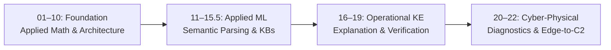

<h1 align="center">Hi, I'm Nick Fedchik 👋</h1>

  <b>Go Engineer & Systems Architect</b> — Specializing in deterministic reasoning, expert systems, and verifiable engineering pipelines.

  
  
  
  
  
  
  

---

### 🧠 Engineering Philosophy & Focus

I design and build **deterministic, evidence-backed reasoning systems** in Go — systems engineered for mission-critical R&D, compliance, and engineering domains where stochastic drift and hallucinations are unacceptable.

* **Determinism over Stochastic Guessing**: Replacing naive dense retrieval (RAG) and loose generative loops with semantic compilation, formal ontologies, and verified inference rules.
* **Byte-Exact Evidence Grounding**: Reasoning outputs grounded in immutable source bytes with auditable execution traces and citations.
* **Fail-Closed Refusals**: Explicit, typed refusals when evidence is insufficient or contradictory, adhering strictly to the closed-world assumption.
* **Production Go Engineering**: Clean package architecture, high concurrency, strict dependency budgeting, and predictable latency.

---

### 📚 Featured Research: [Expert Systems for R&D](https://github.com/nick-fedchik/articles/tree/main/ExpertSystem)

Author of a comprehensive 23-part Ukrainian engineering series: **«Експертні системи для R&D: від хаосу до керованих знань»** ([Repository](https://github.com/nick-fedchik/articles)). The series formalizes how to transform heterogeneous engineering artifacts into verifiable knowledge across five mission-critical domains (*Automotive, Aerospace, Medicine, Defense, Law*).

#### Four Pillars of the Series:
1. **Engineering Foundations (01–10)**: Bayesian evolution to evidence AI, enterprise memory, applied discrete math, knowledge pipelines, and treating engineering artifacts as structured data.
2. **Applied ML & Knowledge Engineering (11–15 & 15.5)**: Comparing rules, frames, ontologies, and Case-Based Reasoning (CBR); semantic query compilation; linguistic analysis and overcoming syntax variability vs. determinism.
3. **Operational Knowledge Engineering (16–19)**: Counterfactual and contrastive explanation engines, knowledge elicitation from human experts, safe transition from recommendation to automated action, and rigorous KB verification.
4. **Diagnostics & Cybernetics (20–22)**: Multi-hypothesis diagnostic trees (symptoms vs. causes), continual learning without self-referential bias, and edge-to-backend cybernetics across autonomous and tactical systems.

<b>📖 Click to explore the complete catalog of articles (01–23)</b>

 

| # | Article Title | Focus Area |
|---|---|---|
| **01** | [Експертні системи для R&D: від хаосу до керованих знань](https://github.com/nick-fedchik/articles/blob/main/ExpertSystem/01-Expert-Systems-for-RD.md) · [DOU](https://dou.ua/forums/topic/59793/) | Introduction to R&D Knowledge Systems |
| **02** | [Від теореми Байєса до доказових рішень ШІ](https://github.com/nick-fedchik/articles/blob/main/ExpertSystem/02-Expert-Systems-Evolution-Evidence-UA.md) · [DOU](https://dou.ua/forums/topic/59861/) | Probabilistic & Evidence Evolution |
| **03** | [Експертна система, доказова рекомендація ШІ і корпоративна пам'ять](https://github.com/nick-fedchik/articles/blob/main/ExpertSystem/03-Expert-System-And-Evidence-Memory-UA.md) · [DOU](https://dou.ua/forums/topic/59923/) | Enterprise Knowledge Triad |
| **04** | [Прикладна математика експертних систем](https://github.com/nick-fedchik/articles/blob/main/ExpertSystem/04-Expert-Systems-Applied-Mathematics-UA.md) · [DOU](https://dou.ua/forums/topic/60032/) | Rules, Graphs, Causality & Decision Logic |
| **05** | [Крок від математичного методу до обрання технологій](https://github.com/nick-fedchik/articles/blob/main/ExpertSystem/05-Expert-Systems-Implementation-Stack-UA.md) · [DOU](https://dou.ua/forums/topic/60155/) | Implementation Stack & Tech Choices |
| **06** | [Архітектура експертної системи: від знання до доказового рішення](https://github.com/nick-fedchik/articles/blob/main/ExpertSystem/06-Expert-Systems-Architecture-UA.md) · [DOU](https://dou.ua/forums/topic/60293/) | System Architecture & Contracts |
| **07** | [Інфраструктура виконання експертної системи](https://github.com/nick-fedchik/articles/blob/main/ExpertSystem/07-Expert-Systems-Infrastructure-UA.md) · [DOU](https://dou.ua/forums/topic/60373/) | Hardware, Deployment & Execution Topology |
| **08** | [Експертна система це більше, ніж інформаційно-довідкова система](https://github.com/nick-fedchik/articles/blob/main/ExpertSystem/08-Expert-Systems-Beyond-Reference-UA.md) · [DOU](https://dou.ua/forums/topic/60530/) | Reference vs. Inference Engines |
| **09** | [Артефакти інженерії як дані експертної системи](https://github.com/nick-fedchik/articles/blob/main/ExpertSystem/09-Engineering-Artifacts-As-Data-UA.md) · [DOU](https://dou.ua/forums/topic/60678/) | Code, Git, Commits & Specs as Facts |
| **10** | [Здобуття знань: збирання інженерних знань без хаосу і витоку](https://github.com/nick-fedchik/articles/blob/main/ExpertSystem/10-Knowledge-Acquisition-System-UA.md) · [DOU](https://dou.ua/forums/topic/60842/) | Controlled Knowledge Ingestion Pipelines |
| **11** | [Типи баз знань: правила, фрейми, онтології та прецеденти (CBR)](https://github.com/nick-fedchik/articles/blob/main/ExpertSystem/11-Knowledge-Base-Types-UA.md) · [DOU](https://dou.ua/forums/topic/60963/) | Knowledge Representation Paradigms |
| **12** | [Як навчати експертну систему: знання, іспит і перевірка змін](https://github.com/nick-fedchik/articles/blob/main/ExpertSystem/12-How-Expert-Systems-Learn-UA.md) · [DOU](https://dou.ua/forums/topic/61034/) | Regression Testing & System Learning |
| **13** | [Знайти замало: від людського запитання до доказової відповіді](https://github.com/nick-fedchik/articles/blob/main/ExpertSystem/13-Knowledge-Acquisition-From-Question-To-Evidence-UA.md) | Question Parsing & Proof Formulation |
| **14** | [Філософія для інженера: що машина має право називати знанням](https://github.com/nick-fedchik/articles/blob/main/ExpertSystem/14-Philosophy-For-Expert-Systems-UA.md) | Epistemology of Machine Knowledge |
| **15** | [Як експертна система розуміє текст і не втрачає джерело відповіді](https://github.com/nick-fedchik/articles/blob/main/ExpertSystem/15-Linguistic-Analysis-And-Local-Models-UA.md) | NLP, Local Models & Citation Tracking |
| **15.5** | [Варіативність мови проти детермінізму експертної системи](https://github.com/nick-fedchik/articles/blob/main/ExpertSystem/23-language-variability-vs-expert-system-determinism.md) | Semantic Parsing vs. Naive Vector RAG |
| **16** | [Як експертна система пояснює рішення, відмову й можливість змін](https://github.com/nick-fedchik/articles/blob/main/ExpertSystem/16-Expert-System-Explanation-Engine-UA.md) | Contrastive & Counterfactual Explanations |
| **17** | [Як перетворити досвід експерта на перевірюване знання](https://github.com/nick-fedchik/articles/blob/main/ExpertSystem/17-Knowledge-Elicitation-From-Experts-UA.md) | Expert Knowledge Elicitation Protocols |
| **18** | [Коли експертній системі можна діяти: від рекомендації до дії](https://github.com/nick-fedchik/articles/blob/main/ExpertSystem/18-Expert-System-From-Recommendation-To-Action-UA.md) | Controlled Action Execution & Guardrails |
| **19** | [Як перевірити, чи можна довіряти правилам експертної системи](https://github.com/nick-fedchik/articles/blob/main/ExpertSystem/19-Expert-System-Knowledge-Base-Verification-UA.md) | Verification, Invariants & Soundness |
| **20** | [Діагностика: як не сплутати симптом із причиною](https://github.com/nick-fedchik/articles/blob/main/ExpertSystem/20-Expert-System-Diagnosis-UA.md) | Root-Cause Analysis & Diagnostic Trees |
| **21** | [Як експертна система вчиться на досвіді й не повторює помилок](https://github.com/nick-fedchik/articles/blob/main/ExpertSystem/21-Expert-System-Continual-Learning-UA.md) | Continual Learning & Log Debiasing |
| **22** | [Кібернетика XXI століття: від датчика до центру керування](https://github.com/nick-fedchik/articles/blob/main/ExpertSystem/22-Cybernetics-Expert-Systems-Edge-Backend-UA.md) | Cyber-Physical, Robotics & C2 Systems |

#### Additional Writing Series:
* **[Military Cybernetics & MilTech](https://github.com/nick-fedchik/articles/tree/main/MilTech)**: Analysis of the Ukrainian military cybernetics heritage (Glushkov tradition), UAS swarms, Air Defense (ППО), Electronic Warfare (РЕБ), and Signal Intelligence (РЕР).
* **[Information Security](https://github.com/nick-fedchik/articles/tree/main/Inform_Security)**: Architectural evolution of cybersecurity, defense-in-depth, and formal guarantees.
* **[R&D & Program Engineering](https://github.com/nick-fedchik/articles/tree/main/Project_Management)**: *Release Evidence as an Engineering Discipline*, WBS decomposition challenges in HW/SW co-design, and project governance in the AI era.

---

### 📝 Статті на [DOU.ua](https://dou.ua/users/nikolajfedchik/articles/)

Цикл інженерних статей та прикладних досліджень, опублікованих у технічному розділі [DOU.ua](https://dou.ua/users/nikolajfedchik/articles/), присвячених архітектурі доказових експертних систем, управлінню знаннями та практичному ШІ в R&D:

1. **[Експертні системи для R&D: від корпоративного хаосу до керованих знань](https://dou.ua/forums/topic/59793/)**  
   У зрілих інженерних компаніях знання часто розпорошені між кодом, Jira, Wiki та головами експертів. Через це гальмує онбординг, а старі помилки повторюються. Аналіз того, як сучасні експертні системи для R&D зшивають цей хаос у єдину пам’ять організації і чому це значно більше за звичайний чат-бот.

2. **[Експертні системи: від теореми Байєса до доказових рішень ШІ](https://dou.ua/forums/topic/59861/)**  
   Сьогодні від ШІ потрібен не гарний текст, а чіткі докази та формальна верифікація. Як спадщина класичних експертних систем 70-х років допомагає контролювати сучасні LLM: теорема Байєса, PROLOG, гібридний RAG та чотири головні уроки для побудови надійних систем.

3. **[Експертна система, доказова рекомендація ШІ і корпоративна пам’ять: три кути одного трикутника](https://dou.ua/forums/topic/59923/)**  
   Розмежування базових понять інженерії знань: чим експертна система відрізняється від мовного інтерфейсу, як правильно формувати доказові рекомендації за допомогою ШІ та за якими принципами функціонує корпоративна пам’ять організації без ризику втрати експертизи.

4. **[Прикладна математика експертних систем: від правил і ймовірностей до графів, причинності та рішень](https://dou.ua/forums/topic/60032/)**  
   Велика мовна модель може гарно говорити, але коли на її висновок треба спертися у відповідальному рішенні — потрібна математична строгість. Детальний розбір математичного фундаменту доказових систем: правила, ймовірності, графи, причинність та оптимізація рішень.

5. **[Експертні системи: крок від математичного методу до обрання технологій](https://dou.ua/forums/topic/60155/)**  
   Поки не зрозумієш, до якого математичного класу належить задача, вибір бібліотеки перетворюється на колекціонування модних назв. Огляд класів інструментів (рушії правил, онтологічні сховища, RAG, оптимізатори) та задач, які закриває кожен із них.

6. **[Архітектура експертної системи: від знання до доказового рішення](https://dou.ua/forums/topic/60293/)**  
   Чому векторна база не може бути єдиним джерелом істини. Архітектура референсної експертної системи: фізичні форми знань, перетворення семантичної схожості на перевірюваний висновок за допомогою графів, контрактів, рушіїв правил та наскрізного аудиту походження даних (provenance).

7. **[Інфраструктура виконання експертної системи: моделі, апаратура і розміщення](https://dou.ua/forums/topic/60373/)**  
   Як влаштована інфраструктура виконання доказових систем: чому різні класи математики вимагають різного заліза (CPU для правил і графів, GPU/NPU для векторів і LLM), топології від хмари до периферії (edge), показники FLOPS/TOPS, обмеження SWaP та числовий дрейф ембедера.

8. **[Експертна система — це дещо більше, ніж інформаційно-довідкова система](https://dou.ua/forums/topic/60530/)**  
   Принципова межа між інформаційно-довідковою системою (пошук, RAG) та повноцінною експертною системою. Різниця між документом-довідкою та експертним висновком, роль робочої пам’яті, валідація походження даних і те, чому згенерована відповідь LLM усе ще не є доказом.

9. **[Детекція знань у документах: як код відділяє факти від шуму, а модель дає їм ім’я](https://dou.ua/forums/topic/60526/)**  
   Практичне дослідження та бенчмарк на корпусі з 9 746 RFC-документів: детермінований Go-код самостійно визначає предметні домени й відділяє факти від шуму, а локальний NPU виконує типізацію знань точніше і приблизно в 130 разів швидше за 7-мільярдну генеративну модель.

10. **[Артефакти інженерії як дані експертної системи](https://dou.ua/forums/topic/60678/)**  
    Документ у R&D — це лише форма подання, а не джерело істини. Як перетворити тексти, специфікації та PDF на структуровані об’єкти даних для ШІ; конвеєр переробки знань і чому якісні системні вимоги мають проєктуватися як якісний код.

11. **[Здобуття знань для експертної системи: як збирати інженерні знання без хаосу і витоку даних](https://dou.ua/forums/topic/60842/)**  
    Як перетворити сирий корпоративний масив файлів на керовану базу знань. Практичні підходи до уникнення застарілих даних, запобігання витокам конфіденційної інформації та захисту від непідтверджених галюцинацій ШІ.

12. **[Типи баз знань для експертних систем: чому правила, фрейми, онтології та випадки дають різні висновки](https://dou.ua/forums/topic/60963/)**  
    Чому база знань, семантичний пошук та експертна система не є синонімами. Порівняльний розбір правил, онтологій, баз прецедентів (CBR) та векторних індексів: що вони повертають, типові помилки кожного підходу та чому семантична схожість ще не є доказом.

13. **[Як навчати експертну систему: знання, іспит і перевірка змін](https://dou.ua/forums/topic/61034/)**  
    Знання в експертній системі старіють разом із вимогами та тестами. Кероване проведення змін: фаховий перегляд (expert review), іспит на еталонному наборі з перевіркою правильних відмов (fail-closed) та калібрування впевненості системи.

---

### 🛠️ Featured Open Source Projects

* 🚀 **[codex-fleet](https://github.com/nick-fedchik/codex-fleet)** — *Lightweight distributed runner for multi-host Ollama worker clusters (Go).* 
  Orchestrates parallel local LLM/embedding inference across distributed nodes with health monitoring, automated failover, SSH checks, and worker warmups.
* 🧰 **[gltk](https://github.com/nick-fedchik/gltk)** — *GitLab Automation & Administration Toolkit (Go).* 
  High-performance CLI built on Cobra for GitLab management: runner orchestrations, CI artifact pipelines, user lifecycle management, and security audits.
* 📐 **[articles](https://github.com/nick-fedchik/articles)** — *Monograph-grade articles on expert systems, cybernetics, and engineering discipline.* 
  Featuring LaTeX/MathJax formulas, Mermaid architectural schematics, and automated Markdown/KaTeX verification pipelines.

---

### 💬 Let's Connect

* **Topics to discuss**: Deterministic rule engines, Knowledge Graphs, Semantic Parsing, Go systems architecture, Military Cybernetics, Evidence-governed engineering.
* **LinkedIn**: [linkedin.com/in/nickfedchik](https://www.linkedin.com/in/nickfedchik/)
* **DOU**: [dou.ua/users/nikolajfedchik](https://dou.ua/users/nikolajfedchik/articles/)
* **GitHub**: [@nick-fedchik](https://github.com/nick-fedchik)

---

  
  

