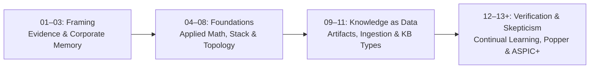

<h1 align="center">Hi, I'm Mykola Fedchyk 👋</h1>

  <b>Go Engineer & Systems Architect</b> — Specializing in deterministic reasoning, expert systems, and verifiable engineering pipelines.

  
  
  
  
  
  
  

---

### 🧠 Engineering Philosophy & Focus

I design and build **deterministic, evidence-backed reasoning systems** in Go — systems engineered for mission-critical R&D, compliance, and engineering domains where stochastic drift and hallucinations are unacceptable.

* **Determinism over Stochastic Guessing**: Replacing naive dense retrieval (RAG) and loose generative loops with semantic compilation, formal ontologies, and verified inference rules.
* **Byte-Exact Evidence Grounding**: Reasoning outputs grounded in immutable source bytes with auditable execution traces and citations.
* **Fail-Closed Refusals**: Explicit, typed refusals when evidence is insufficient or contradictory, adhering strictly to the closed-world assumption.
* **Production Go Engineering**: Clean package architecture, high concurrency, strict dependency budgeting, and predictable latency.

---

### 📚 Engineering Monographs

#### 1. Architecture of Evidence-Based Expert Systems: From Formal Ontologies to Neuro-Symbolic AI
*Comprehensive Monograph · 7 parts, 40 chapters, 5 appendices (2026)*

A foundational study on overcoming the central crisis of modern AI: the **epistemic breach** between the stochastic plausibility of autoregressive neural networks (LLM/SLM) and the deterministic truth of formal logical proofs. Formulates the paradigm of **Evidence-Grounded Neuro-Symbolic AI (Third-Wave NeSy)** — statistical models act in an advisory capacity (System 1) for hypothesis generation and semantic parsing, while a deterministic symbolic core (System 2) strictly enforces formal invariants, byte-exact grounding, and fail-closed safety envelopes.

* **Evidence-Grounded Invariant (EGI)**: Continuous byte-exact custody `[byte_start, byte_end]`, cryptographic SHA-256 hashes, and W3C PROV-O provenance, guaranteeing zero hallucination ($`\mathrm{ZHR} = 1.00`$) and fail-closed refusal precision ($`\mathrm{FCP} = 100\%`$).
* **High-Performance Knowledge Packs (`mmap`)**: POSIX `mmap` dual-layer binary storage (canonical evidence bedrock + materialized graph index) for zero-allocation, sub-linear engine startup regardless of ontology volume.
* **Knowledge Testing Pyramid (KTP)**: 4-tier verification (KUT unit mocks, KIT rule lattices, KVT variational tests) ensuring semantic invariance ($`\mathrm{SIS} \ge 0.98`$) and Lipschitz continuity ($`L_{\mathcal{K}} \le L_{\max}`$) to eliminate relay chattering.
* **Popperian Falsification & ASPIC+**: Active Compliance Auditor synthesizing counter-examples, conflict resolution under Dung/Walton argumentation frameworks, and runtime Falsification Gates withstanding *Undermining*, *Undercutting*, and *Rebutting* attacks.
* **Formal Safety Cases (GSN)**: Direct compilation of Engineering Knowledge Graphs (EKG) into Goal Structuring Notation trees for simultaneous functional safety and cybersecurity compliance (ISO 26262 ASIL-D, IEC 61508 SIL-3, DO-178C DAL-A, ISO/SAE 21434).
* **Hardware Execution (EPU)**: Real-time silicon knowledge processors benchmarked on NVIDIA Jetson AGX Orin (64GB) + dual Xilinx Zynq-7020 FPGAs over Zero-Copy federated arenas, ensuring deterministic sub-microsecond inference.

*Structure: Part I (Epistemic Foundations) · Part II (Mathematical Models) · Part III (Knowledge Extraction & NLP) · Part IV (Core Architecture & Inference) · Part V (Verification & Safety Cases) · Part VI (Neuro-Symbolic Frontiers) · Part VII (Distributed Cybernetic Runtime).*

---

#### 2. Managing Complex Engineering Projects and Programmes
*From Work Breakdown Structure to Digital Thread and Evidence-Based Release · 6 parts, 18 chapters, 3 appendices*

Systems engineering guide on hybrid planning for HW/SW co-design, baseline management, digital thread traceability connecting requirements, code, tests, and evidence, event-driven governance, and AI-assisted PMO platforms.

---

#### 3. The Evolution of Cybersecurity: From the First Modem to Autonomous Systems
*Popular-Science Monograph · 10 chapters, 2 appendices*

Traces architectural zero trust from 1970s time-sharing systems to telecommunications, ICS/SCADA, connected vehicles, UAV swarms, and space assets.

---

#### 4. Military Cybernetics of the Early 21st Century
*Control Systems, Cyber-Physical Complexes and Evidence-Based Intelligence · 4 parts, 12 chapters*

Theoretical foundations and modern applications of the Ukrainian cybernetic school (Glushkov tradition), GNSS-denied navigation, autonomous swarm robotics, multi-echelon C2 architectures, and hardware roots of trust (based strictly on open-source research).

---

### 🔬 Engineering Research Series: Expert Systems for R&D

An ongoing technical research series (over 75,000 words across 13 published works and active milestones) establishing the full engineering lifecycle of evidence-grounded expert systems in R&D:

#### Four Architectural Pillars:

1. **Pillar I. Framing & Epistemic Boundaries (Articles 01–03)**  
   *The R&D Manifest and the Triad of Trust.* Overcoming the stochastic drift of LLMs; formalizing the epistemic boundary between conversational chatbots, evidence-based recommendations, and immutable corporate memory; tracing probabilistic evolution from Bayes' theorem to verifiable inference.
2. **Pillar II. Applied Mathematics & System Infrastructure (Articles 04–08)**  
   *From Mathematical Models to Execution Topologies.* Concrete formalisms for production engineering: production rules, causal DAGs (Pearl), Markov processes, Case-Based Reasoning (CBR); implementation tech stack selection; reference system architecture; physical compute sizing across CPU, GPU, and NPU architectures under SWaP constraints; defining the strict boundary between search/retrieval systems and expert inference engines.
3. **Pillar III. Knowledge as Structured Engineering Data (Articles 09–11)**  
   *Ingestion, Slicing, and Formal Representation.* Transforming engineering artifacts (code, Git history, specifications, regulatory standards) into structured data; automated knowledge acquisition pipelines with strict confidentiality and leak-prevention controls; comparative evaluation of knowledge base topologies (rules, frames, ontologies, cases) under Open vs. Closed World Assumptions.
4. **Pillar IV. Continual Learning & Algorithmic Skepticism (Articles 12–13+)**  
   *Verification, Falsification, and Non-Regressive Adaptation.* The knowledge lifecycle, structured expert review, examination batteries, and fail-closed regression checks; Popperian falsification and the architectural *Falsification Gate*; defending against confirmation bias via structured attacks (*Undermining, Undercutting, Rebutting*) under the ASPIC+ argumentation framework.

---

### 📝 Статті на [DOU.ua](https://dou.ua/users/nikolajfedchik/articles/)

Цикл інженерних статей та прикладних досліджень, опублікованих у технічному розділі [DOU.ua](https://dou.ua/users/nikolajfedchik/articles/), присвячених архітектурі доказових експертних систем, управлінню знаннями та практичному ШІ в R&D:

1. **[Експертні системи для R&D: від корпоративного хаосу до керованих знань](https://dou.ua/forums/topic/59793/)**  
   У зрілих інженерних компаніях знання часто розпорошені між кодом, Jira, Wiki та головами експертів. Через це гальмує онбординг, а старі помилки повторюються. Аналіз того, як сучасні експертні системи для R&D зшивають цей хаос у єдину пам’ять організації і чому це значно більше за звичайний чат-бот.

2. **[Експертні системи: від теореми Байєса до доказових рішень ШІ](https://dou.ua/forums/topic/59861/)**  
   Сьогодні від ШІ потрібен не гарний текст, а чіткі докази та формальна верифікація. Як спадщина класичних експертних систем 70-х років допомагає контролювати сучасні LLM: теорема Байєса, PROLOG, гібридний RAG та чотири головні уроки для побудови надійних систем.

3. **[Експертна система, доказова рекомендація ШІ і корпоративна пам’ять: три кути одного трикутника](https://dou.ua/forums/topic/59923/)**  
   Розмежування базових понять інженерії знань: чим експертна система відрізняється від мовного інтерфейсу, як правильно формувати доказові рекомендації за допомогою ШІ та за якими принципами функціонує корпоративна пам’ять організації без ризику втрати експертизи.

4. **[Прикладна математика експертних систем: від правил і ймовірностей до графів, причинності та рішень](https://dou.ua/forums/topic/60032/)**  
   Велика мовна модель може гарно говорити, але коли на її висновок треба спертися у відповідальному рішенні — потрібна математична строгість. Детальний розбір математичного фундаменту доказових систем: правила, ймовірності, графи, причинність та оптимізація рішень.

5. **[Експертні системи: крок від математичного методу до обрання технологій](https://dou.ua/forums/topic/60155/)**  
   Поки не зрозумієш, до якого математичного класу належить задача, вибір бібліотеки перетворюється на колекціонування модних назв. Огляд класів інструментів (рушії правил, онтологічні сховища, RAG, оптимізатори) та задач, які закриває кожен із них.

6. **[Архітектура експертної системи: від знання до доказового рішення](https://dou.ua/forums/topic/60293/)**  
   Чому векторна база не може бути єдиним джерелом істини. Архітектура референсної експертної системи: фізичні форми знань, перетворення семантичної схожості на перевірюваний висновок за допомогою графів, контрактів, рушіїв правил та наскрізного аудиту походження даних (provenance).

7. **[Інфраструктура виконання експертної системи: моделі, апаратура і розміщення](https://dou.ua/forums/topic/60373/)**  
   Як влаштована інфраструктура виконання доказових систем: чому різні класи математики вимагають різного заліза (CPU для правил і графів, GPU/NPU для векторів і LLM), топології від хмари до периферії (edge), показники FLOPS/TOPS, обмеження SWaP та числовий дрейф ембедера.

8. **[Експертна система — це дещо більше, ніж інформаційно-довідкова система](https://dou.ua/forums/topic/60530/)**  
   Принципова межа між інформаційно-довідковою системою (пошук, RAG) та повноцінною експертною системою. Різниця між документом-довідкою та експертним висновком, роль робочої пам’яті, валідація походження даних і те, чому згенерована відповідь LLM усе ще не є доказом.

9. **[Детекція знань у документах: як код відділяє факти від шуму, а модель дає їм ім’я](https://dou.ua/forums/topic/60526/)**  
   Практичне дослідження та бенчмарк на корпусі з 9 746 RFC-документів: детермінований Go-код самостійно визначає предметні домени й відділяє факти від шуму, а локальний NPU виконує типізацію знань точніше і приблизно в 130 разів швидше за 7-мільярдну генеративну модель.

10. **[Артефакти інженерії як дані експертної системи](https://dou.ua/forums/topic/60678/)**  
    Документ у R&D — це лише форма подання, а не джерело істини. Як перетворити тексти, специфікації та PDF на структуровані об’єкти даних для ШІ; конвеєр переробки знань і чому якісні системні вимоги мають проєктуватися як якісний код.

11. **[Здобуття знань для експертної системи: як збирати інженерні знання без хаосу і витоку даних](https://dou.ua/forums/topic/60842/)**  
    Як перетворити сирий корпоративний масив файлів на керовану базу знань. Практичні підходи до уникнення застарілих даних, запобігання витокам конфіденційної інформації та захисту від непідтверджених галюцинацій ШІ.

12. **[Типи баз знань для експертних систем: чому правила, фрейми, онтології та випадки дають різні висновки](https://dou.ua/forums/topic/60963/)**  
    Чому база знань, семантичний пошук та експертна система не є синонімами. Порівняльний розбір правил, онтологій, баз прецедентів (CBR) та векторних індексів: що вони повертають, типові помилки кожного підходу та чому семантична схожість ще не є доказом.

13. **[Як навчати експертну систему: знання, іспит і перевірка змін](https://dou.ua/forums/topic/61034/)**  
    Знання в експертній системі старіють разом із вимогами та тестами. Кероване проведення змін: фаховий перегляд (expert review), іспит на еталонному наборі з перевіркою правильних відмов (fail-closed) та калібрування впевненості системи.

14. **Поппер проти ШІ: як навчити систему спростовувати саму себе до того, як це зробить продакшен** *(готується до публікації)*  
    Чому наївна автоматизація та патерн LLM-as-a-Judge створюють оманливу ілюзію безпеки. Як побудувати захисний Falsification Gate на засадах попперівського фальсифікаціонізму та оскаржуваних міркувань ASPIC+: розбір трьох класів атак (Undermining, Undercutting, Rebutting) та детермінований Fail-Closed інваріант.

---

### 🛠️ Featured Open Source & Engineering Projects

* 🚀 **[codex-fleet](https://github.com/nick-fedchik/codex-fleet)** — *Lightweight distributed runner for multi-host Ollama worker clusters (Go).* 
  Orchestrates parallel local LLM/embedding inference across distributed nodes with health monitoring, automated failover, SSH checks, and worker warmups.
* 🧰 **[gltk](https://github.com/nick-fedchik/gltk)** — *GitLab Automation & Administration Toolkit (Go).* 
  High-performance CLI built on Cobra for GitLab management: runner orchestrations, CI artifact pipelines, user lifecycle management, and security audits.
* 📐 **Research & Publication Corpus** — *Monograph-grade engineering research on expert systems, cybernetics, and mission-critical systems engineering.* 
  Mathematical formalisms (KaTeX/MathJax), Mermaid architectural schematics, and automated Markdown verification pipelines.

---

### 💬 Let's Connect

* **Topics to discuss**: Deterministic rule engines, Knowledge Graphs, Semantic Parsing, Go systems architecture, Military Cybernetics, Evidence-governed engineering.
* **LinkedIn**: [linkedin.com/in/nickfedchik](https://www.linkedin.com/in/nickfedchik/)
* **DOU**: [dou.ua/users/nikolajfedchik](https://dou.ua/users/nikolajfedchik/articles/)
* **GitHub**: [@nick-fedchik](https://github.com/nick-fedchik)

---

  
  

