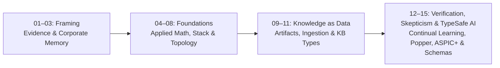

<h1 align="center">Hi, I'm Mykola Fedchyk 👋</h1>

  <b>Computer systems (software/hardware) Engineer & Systems Architect</b> — Specializing in deterministic reasoning, expert systems, and verifiable engineering pipelines.

  
  
  
  
  
  
  
  

---

### 🧠 Engineering Philosophy & Focus

I design and build **deterministic, evidence-backed reasoning systems** in Go — systems engineered for mission-critical R&D, compliance, and engineering domains where stochastic drift and hallucinations are unacceptable.

* **Determinism over Stochastic Guessing**: Replacing naive dense retrieval (RAG) and loose generative loops with semantic compilation, formal ontologies, and verified inference rules.
* **Byte-Exact Evidence Grounding**: Reasoning outputs grounded in immutable source bytes with auditable execution traces, two-column PDF geometric reconstruction, and morphological role verification.
* **Three-Plane Formal SMT Verification**: Proving rule consistency (`unsat-core`), resolving composite boolean exceptions, and verifying multi-cycle hardware pipelines via industrial SMT solvers (Microsoft Z3 over `QF_LRA`, `QF_UF`, and `QF_BV`).
* **Fail-Closed Refusals**: Explicit, typed refusals when evidence is insufficient or contradictory, adhering strictly to the closed-world assumption ($`\mathrm{ZHR} = 1.00`$).
* **Production Go Engineering**: Clean package architecture, zero-copy `mmap` binary containers, high concurrency, strict dependency budgeting, and predictable latency.

---

### 📚 Engineering Monographs & Textbooks

#### 1. [Architecture of Evidence-Based Expert Systems: From Formal Ontologies to Neuro-Symbolic AI](https://github.com/nick-fedchik/articles/tree/main/Expert_Systems_Architecture)
*Comprehensive Monograph · 7 parts, 40 chapters (2026)*

A foundational study on overcoming the central crisis of modern AI: the **epistemic breach** between the stochastic plausibility of autoregressive neural networks (LLM/SLM) and the deterministic truth of formal logical proofs. Formulates the paradigm of **Evidence-Grounded Neuro-Symbolic AI (Third-Wave NeSy)** — statistical models act strictly in an advisory capacity (System 1) under operational hygiene gates (reasoning-effort budgeting, asymmetric `FP16/Q8_0` KV-cache sizing, context-shift prohibition, and behavioral self-tests), while a deterministic symbolic core (System 2) enforces formal invariants, byte-exact grounding, and fail-closed safety envelopes.

* **Evidence-Grounded Invariant (EGI) & Speech-Act Segregation**: Continuous byte-exact custody `[byte_start, byte_end]`, SHA-256 verification, whitespace-valley geometric reconstruction for multi-column PDFs, FST morphosyntactic case-syncretism resolution (`SVO` vs `OVS`), and Searle constitutive enactment segregation, guaranteeing zero hallucination ($`\mathrm{ZHR} = 1.00`$).
* **High-Performance Knowledge Packs (`mmap`) & Verdict-Blind Routing (`Recall@K`)**: Zero-copy memory-mapped binary containers with CSR concept graphs ($> 1.1 \times 10^6$ concept nodes), verified anaphoric subject rebinding (`COREFERS_TO`), and verdict-blind candidate routing achieving $100\%$ pack recall on positive controls and $94.6\%$ on blind paraphrases ($96.6\%$ in Ukrainian).
* **Three-Plane Formal SMT Verification (Z3)**: Unified formal verification across `QF_LRA`, `QF_UF`, and `QF_BV` — offline knowledge container consistency auditing with minimal `unsat-core` extraction, runtime resolution of composite boolean exceptions (`unless A and B`), and 24-cycle bounded/inductive hardware RTL verification with non-vacuity witnesses and $100\%$ mutant detection.
* **Knowledge Testing Pyramid (KTP) & Calibration**: 4-tier verification (KUT unit mocks, KIT rule lattices, KVT variational tests) and two-rule Cohen's $\kappa$ stub-gate calibration ($`\kappa = 0.805 > 0.80`$), ensuring semantic invariance ($`\mathrm{SIS} \ge 0.98`$) and Lipschitz continuity ($`L_{\mathcal{K}} \le L_{\max}`$).
* **Popperian Falsification & ASPIC+**: Active Compliance Auditor synthesizing counter-examples, cross-standard priority arbitration (`supersedes` / `overrides`) over canonical claim scopes, and runtime Falsification Gates withstanding *Undermining*, *Undercutting*, and *Rebutting* attacks.
* **Formal Safety Cases (GSN) & Hardware Execution (EPU)**: Direct compilation of Engineering Knowledge Graphs into Goal Structuring Notation trees (ISO 26262 ASIL-D, IEC 61508 SIL-3, DO-178C DAL-A, ISO/SAE 21434) and real-time silicon knowledge processors benchmarked on NVIDIA Jetson AGX Orin (64GB) + Xilinx Zynq-7020 FPGAs.

*Structure: Part I (Epistemic Foundations) · Part II (Mathematical Models) · Part III (Knowledge Extraction & NLP) · Part IV (Core Architecture & Inference) · Part V (Verification & Safety Cases) · Part VI (Neuro-Symbolic Frontiers) · Part VII (Distributed Cybernetic Runtime).*

---

#### 2. [Expert Systems: Software Engineering, Formal Reasoning, and Neuro-Symbolic Practice](https://github.com/nick-fedchik/articles/tree/main/Expert_Systems)
*Three-Volume University & Practitioner Textbook · 3 volumes, 30 chapters, executable Python 3.14 verification listings (2026)*

A hands-on engineering textbook bridging formal logic, applied mathematics, and production software implementation for computer science students and systems engineers:

* **[Volume 1 (Chapters 1–10): Logical Foundations & Classical Inference](https://github.com/nick-fedchik/articles/tree/main/Expert_Systems/Volume-1)** — Belnap four-valued logic, incomplete and conflicting evidence, production rules and decision tables, Rete/treat production networks, forward/backward chaining, truth maintenance systems (JTMS/ATMS), constraint satisfaction, and counterfactual explanations/repairs.
* **[Volume 2 (Chapters 11–20): Knowledge Engineering, Normative Argumentation & Formal Verification](https://github.com/nick-fedchik/articles/tree/main/Expert_Systems/Volume-2)** — Knowledge acquisition and representation, local language models in knowledge engineering, knowledge graphs and digital thread traceability, deontic logic, constitutive acts, and structured ASPIC+ argumentation, formal SMT verification with minimal `unsat-core` isolation and non-vacuity checks, model-based diagnosis, and temporal prediction.
* **[Volume 3 (Chapters 21–30): Neuro-Symbolic Systems, Extraction Pipelines & Distributed Execution](https://github.com/nick-fedchik/articles/tree/main/Expert_Systems/Volume-3)** — Isolated neuro-symbolic architectures, zero-shot entity/relation extraction, multi-column PDF layout recovery and Ukrainian `SVO/OVS` morphosyntactic disambiguation, grammar-constrained decoding, hybrid lexical/vector/graph retrieval, verdict-blind `Recall@K` evaluation and verified subject rebinding, controlled execution, hardware acceleration, and distributed expert systems.

---

#### 3. [Military Cybernetics of the Early 21st Century](https://github.com/nick-fedchik/articles/tree/main/MilTech)
*Control Systems, Cyber-Physical Complexes and Evidence-Based Intelligence · 4 parts, 12 chapters*

Theoretical foundations and modern applications of the Ukrainian cybernetic school (Glushkov tradition), GNSS-denied navigation, autonomous swarm robotics, multi-echelon C2 architectures, and hardware roots of trust (based strictly on open-source research).

---

### 🔬 Engineering Research Series: Expert Systems for R&D

An ongoing technical research series (15 published articles on DOU.ua) establishing the full engineering lifecycle of evidence-grounded expert systems in R&D:

#### Four Architectural Pillars:

1. **Pillar I. Framing & Epistemic Boundaries (Articles 01–03)**  
   *The R&D Manifest and the Triad of Trust.* Overcoming the stochastic drift of LLMs; formalizing the epistemic boundary between conversational chatbots, evidence-based recommendations, and immutable corporate memory; tracing probabilistic evolution from Bayes' theorem to verifiable inference.
2. **Pillar II. Applied Mathematics & System Infrastructure (Articles 04–08)**  
   *From Mathematical Models to Execution Topologies.* Concrete formalisms for production engineering: production rules, causal DAGs (Pearl), Markov processes, Case-Based Reasoning (CBR); implementation tech stack selection; reference system architecture; physical compute sizing across CPU, GPU, and NPU architectures under SWaP constraints; defining the strict boundary between search/retrieval systems and expert inference engines.
3. **Pillar III. Knowledge as Structured Engineering Data (Articles 09–11)**  
   *Ingestion, Slicing, and Formal Representation.* Transforming engineering artifacts (code, Git history, specifications, regulatory standards) into structured data; automated knowledge acquisition pipelines with strict confidentiality and leak-prevention controls; comparative evaluation of knowledge base topologies (rules, frames, ontologies, cases) under Open vs. Closed World Assumptions.
4. **Pillar IV. Continual Learning, Algorithmic Skepticism & TypeSafe AI (Articles 12–15)**  
   *Verification, Falsification, and Schema-Constrained Boundaries.* The knowledge lifecycle, structured expert review, examination batteries, and fail-closed regression checks; Popperian falsification and the architectural *Falsification Gate* under ASPIC+ (*Undermining, Undercutting, Rebutting*); and why grammar/schema-constrained JSON generation (*TypeSafe AI*) guarantees syntactic validity without proving domain truth unless paired with a deterministic expert system.

---

### 📝 Статті на [DOU.ua](https://dou.ua/users/nikolajfedchik/articles/)

Цикл із 15 інженерних статей та прикладних досліджень, опублікованих у технічному розділі [DOU.ua](https://dou.ua/users/nikolajfedchik/articles/), присвячених архітектурі доказових експертних систем, управлінню знаннями та практичному ШІ в R&D:

1. **[Експертні системи для R&D: від корпоративного хаосу до керованих знань](https://dou.ua/forums/topic/59793/)**  
   У зрілих інженерних компаніях знання часто розпорошені між кодом, Jira, Wiki та головами експертів. Через це гальмує онбординг, а старі помилки повторюються. Аналіз того, як сучасні експертні системи для R&D зшивають цей хаос у єдину пам’ять організації і чому це значно більше за звичайний чат-бот.

2. **[Експертні системи: від теореми Байєса до доказових рішень ШІ](https://dou.ua/forums/topic/59861/)**  
   Сьогодні від ШІ потрібен не гарний текст, а чіткі докази та формальна верифікація. Як спадщина класичних експертних систем 70-х років допомагає контролювати сучасні LLM: теорема Байєса, PROLOG, гібридний RAG та чотири головні уроки для побудови надійних систем.

3. **[Експертна система, доказова рекомендація ШІ і корпоративна пам’ять: три кути одного трикутника](https://dou.ua/forums/topic/59923/)**  
   Розмежування базових понять інженерії знань: чим експертна система відрізняється від мовного інтерфейсу, як правильно формувати доказові рекомендації за допомогою ШІ та за якими принципами функціонує корпоративна пам’ять організації без ризику втрати експертизи.

4. **[Прикладна математика експертних систем: від правил і ймовірностей до графів, причинності та рішень](https://dou.ua/forums/topic/60032/)**  
   Велика мовна модель може гарно говорити, але коли на її висновок треба спертися у відповідальному рішенні — потрібна математична строгість. Детальний розбір математичного фундаменту доказових систем: правила, ймовірності, графи, причинність та оптимізація рішень.

5. **[Експертні системи: крок від математичного методу до обрання технологій](https://dou.ua/forums/topic/60155/)**  
   Поки не зрозумієш, до якого математичного класу належить задача, вибір бібліотеки перетворюється на колекціонування модних назв. Огляд класів інструментів (рушії правил, онтологічні сховища, RAG, оптимізатори) та задач, які закриває кожен із них.

6. **[Архітектура експертної системи: від знання до доказового рішення](https://dou.ua/forums/topic/60293/)**  
   Чому векторна база не може бути єдиним джерелом істини. Архітектура референсної експертної системи: фізичні форми знань, перетворення семантичної схожості на перевірюваний висновок за допомогою графів, контрактів, рушіїв правил та наскрізного аудиту походження даних (provenance).

7. **[Інфраструктура виконання експертної системи: моделі, апаратура і розміщення](https://dou.ua/forums/topic/60373/)**  
   Як влаштована інфраструктура виконання доказових систем: чому різні класи математики вимагають різного заліза (CPU для правил і графів, GPU/NPU для векторів і LLM), топології від хмари до периферії (edge), показники FLOPS/TOPS, обмеження SWaP та числовий дрейф ембедера.

8. **[Експертна система — це дещо більше, ніж інформаційно-довідкова система](https://dou.ua/forums/topic/60530/)**  
   Принципова межа між інформаційно-довідковою системою (пошук, RAG) та повноцінною експертною системою. Різниця між документом-довідкою та експертним висновком, роль робочої пам’яті, валідація походження даних і те, чому згенерована відповідь LLM усе ще не є доказом.

9. **[Детекція знань у документах: як код відділяє факти від шуму, а модель дає їм ім’я](https://dou.ua/forums/topic/60526/)**  
   Практичне дослідження та бенчмарк на корпусі з 9 746 RFC-документів: детермінований Go-код самостійно визначає предметні домени й відділяє факти від шуму, а локальний NPU виконує типізацію знань точніше і приблизно в 130 разів швидше за 7-мільярдну генеративну модель.

10. **[Артефакти інженерії як дані експертної системи](https://dou.ua/forums/topic/60678/)**  
    Документ у R&D — це лише форма подання, а не джерело істини. Як перетворити тексти, специфікації та PDF на структуровані об’єкти даних для ШІ; конвеєр переробки знань і чому якісні системні вимоги мають проєктуватися як якісний код.

11. **[Здобуття знань для експертної системи: як збирати інженерні знання без хаосу і витоку даних](https://dou.ua/forums/topic/60842/)**  
    Як перетворити сирий корпоративний масив файлів на керовану базу знань. Практичні підходи до уникнення застарілих даних, запобігання витокам конфіденційної інформації та захисту від непідтверджених галюцинацій ШІ.

12. **[Типи баз знань для експертних систем: чому правила, фрейми, онтології та випадки дають різні висновки](https://dou.ua/forums/topic/60963/)**  
    Чому база знань, семантичний пошук та експертна система не є синонімами. Порівняльний розбір правил, онтологій, баз прецедентів (CBR) та векторних індексів: що вони повертають, типові помилки кожного підходу та чому семантична схожість ще не є доказом.

13. **[Як навчати експертну систему: знання, іспит і перевірка змін](https://dou.ua/forums/topic/61034/)**  
    Знання в експертній системі старіють разом із вимогами та тестами. Кероване проведення змін: фаховий перегляд (expert review), іспит на еталонному наборі з перевіркою правильних відмов (fail-closed) та калібрування впевненості системи.

14. **[Поппер проти ШІ: як навчити систему спростовувати саму себе до того, як це зробить продакшен](https://dou.ua/forums/topic/62793/)**  
    Зелені тести й «Confidence 0.99» від ШІ не захищають прод від чорних лебедів. Як навчити систему алгоритмічного скептицизму, застосувати критерій Поппера й теорію ASPIC+, щоб софт шукав контрприклади проти власних дій ще до деплою (розбір трьох класів атак: Undermining, Undercutting, Rebutting та Fail-Closed інваріанта).

15. **[Коли нейромережі заборонили писати текст: TypeSafe AI проти експертних систем](https://dou.ua/forums/topic/62808/)**  
    Що, якби ШІ замість генерації тексту одразу повертав готові типізовані рішення? Розбір технології TypeSafe AI (GBNF/JSON-схеми), чому синтаксично валідний JSON ще не гарантує правильності інженерних рішень і як поєднання граматично обмежених нейромереж з експертними системами підвищує надійність критичних сервісів.

---

### 🛠️ Featured Open Source & Engineering Projects

* 🔬 **[LogicTracer](https://github.com/nick-fedchik/LogicTracer)** — *Evidence-grade Logic Analyzer for Hardware-in-the-Loop (HIL) & AI Agents (C++20 / Qt 6 / RP2040 / Verilog).* 
  Native host (`logictracer-cli`, `logictracer-gui`), Model Context Protocol server (`logictracer-mcp`), RP2040 firmware, and in-design FPGA capture core (`lt_capture`) delivering deterministic stimulus-to-reaction timing metrology (`Δs` histograms, nearest-rank percentiles, ±1-sample bounds, and automated CI/HIL pass/fail verdicts).
* 📚 **[articles](https://github.com/nick-fedchik/articles)** — *Engineering Monographs & University Textbooks on Expert Systems and Military Cybernetics.* 
  Open repository hosting the 40-chapter monograph *Architecture of Evidence-Based Expert Systems*, the 3-volume university textbook *Expert Systems* (30 chapters with executable verification listings), and *Military Cybernetics of the Early 21st Century* (12 chapters).
* 🚀 **[codex-fleet](https://github.com/nick-fedchik/codex-fleet)** — *Lightweight distributed worker fleet for local LLM orchestration (Go).* 
  Orchestrates parallel local Ollama model inference and embeddings across Linux, Windows, and WSL2 hosts with health monitoring, automated failover, SSH checks, and worker warmups.
* 🧰 **[gltk](https://github.com/nick-fedchik/gltk)** — *GitLab Automation & Administration Toolkit (Go).* 
  High-performance CLI built on Cobra for GitLab management: runner orchestrations, CI artifact pipelines, user lifecycle management, and security audits.
* 🛡️ **[aorus-5-fault-watchdog](https://github.com/nick-fedchik/aorus-5-fault-watchdog)** — *Linux Kernel & Hardware Fault Watchdog (C).* 
  System daemon for detecting, logging, and recovering from low-level NVIDIA GSP firmware and Intel xHCI controller faults on Linux hosts.

---

### 💬 Let's Connect

* **Topics to discuss**: Deterministic rule engines, Knowledge Graphs, Semantic Parsing, Go systems architecture, Military Cybernetics, Evidence-governed engineering.
* **LinkedIn**: [linkedin.com/in/nickfedchik](https://www.linkedin.com/in/nickfedchik/)
* **DOU**: [dou.ua/users/nikolajfedchik](https://dou.ua/users/nikolajfedchik/articles/)
* **GitHub**: [@nick-fedchik](https://github.com/nick-fedchik)

---

  
  

